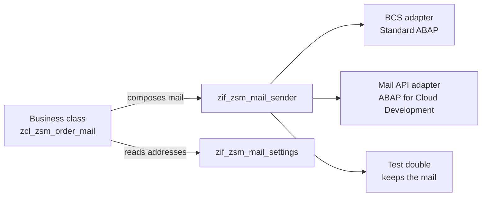

# 24 — Mail (BCS)

> **Lifecycle:** `CURRENT / RECOMMENDED`. Composing a mail in your own class and sending it through an interface is the design for every language version. The mail API `CL_BCS_MAIL_MESSAGE` is the API for ABAP for Cloud Development; the classic BCS classes (`CL_BCS` and its helpers) are `CLASSIC BUT STILL RELEVANT`; the `SO_*_API1` function modules are `LEGACY / HISTORICAL REFERENCE`. See [21-Classic-vs-Modern-ABAP](../21-Classic-vs-Modern-ABAP/README.md).

## 📖 Introduction

A program sends a mail when a person must act on something: an order is late, a job failed, a document waits for approval. ABAP does not talk to a mail server itself. It hands the mail to the **Business Communication Services (BCS)**, which store it and pass it on to a mail server. In Standard ABAP on-premise, the SAPconnect component of the system does that; in an SAP BTP ABAP environment, a communication arrangement names the mail server.

This chapter covers:

- the design: compose the mail in your own class, send it through an interface;
- sending with the classic BCS API (Standard ABAP) and with the mail API `CL_BCS_MAIL_MESSAGE` (ABAP for Cloud Development);
- plain text and HTML bodies, and attachments;
- when the mail actually leaves the system, and where to monitor it;
- exceptions, addresses from configuration, personal data in mail;
- testing mail code without sending a single mail.

A reusable mail component — the same design with configuration, logging and retries built in — belongs to the future ABAP-Cookbook. This chapter describes its design and does not build it.

## 🗺️ Standard ABAP and ABAP for Cloud Development at a Glance

| Topic | Standard ABAP | ABAP for Cloud Development |
|---|---|---|
| API | BCS: `CL_BCS` (send request), `CL_DOCUMENT_BCS` (document), `CL_CAM_ADDRESS_BCS` and further address classes | `CL_BCS_MAIL_MESSAGE` with the body parts `CL_BCS_MAIL_TEXTPART` and `CL_BCS_MAIL_BINARYPART` |
| Release state | — (any API can be used; [Rule 1.3](../docs/ABAP-Development-Rules.md#13-in-standard-abap-prefer-a-released-api-over-an-unreleased-one-when-both-exist)) | The mail API is released; the BCS classes are classified "not to be released", with `CL_BCS_MAIL_MESSAGE` as successor |
| Body | A document of type `HTM` (HTML) or `RAW` (plain text) | A text part, `text/html` or `text/plain` |
| Attachment content | Binary table (`SOLIX_TAB`); helpers in `CL_BCS_CONVERT` | `xstring`; text converted with `cl_abap_conv_codepage` |
| When the mail leaves | After the caller's `COMMIT WORK`, with the next SAPconnect send job, or at once with *send immediately* | `send( )` sends synchronously; `send_async( )` starts after the caller's `COMMIT WORK` |
| Monitoring | Transaction `SOST` | App *Monitor Email Transmissions* |
| Exceptions | `CX_BCS` and its subclasses, `CX_STATIC_CHECK` | `CX_BCS_MAIL`, `CX_STATIC_CHECK` |
| Setup (not a developer task) | SAPconnect nodes and send jobs | A communication arrangement for scenario `SAP_COM_0548` |

> ⚠️ **VERSION-DEPENDENT: the mail API in Standard ABAP.** On the on-premise system used for this chapter, `CL_BCS_MAIL_MESSAGE` existed, and E2 below was activated there as well. SAP's published object classification lists `CL_BCS`, `CL_DOCUMENT_BCS`, `CL_CAM_ADDRESS_BCS` and `CL_SAPUSER_BCS` as classic APIs with `CL_BCS_MAIL_MESSAGE` as successor. Check your release before choosing, and see the [ABAP Keyword Documentation](https://help.sap.com/doc/abapdocu_latest_index_htm/latest/en-US/index.htm) for language versions. **[verify: how the mail API is configured to send in Standard ABAP on-premise]**

## 🧱 Design: Compose the Mail, Send It Through an Interface

Mail code has two parts that change for different reasons:

- **What to send** — subject, body, attachments and recipients — is business logic. It belongs in your own class, which can be tested.
- **How to send** — which API, which document types, which conversions — depends on the language version and the release. It belongs in an adapter behind an interface ([Rule 5.4](../docs/ABAP-Development-Rules.md#54-depend-on-interfaces-and-receive-dependencies-through-the-constructor)).



The adapter never commits. The program that owns the business transaction commits, and with that commit the mail goes on its way ([Rule 7.10](../docs/ABAP-Development-Rules.md#710-let-the-top-level-caller-own-the-transaction-reusable-units-never-commit-work)). A mail about an order that was rolled back is therefore never sent.

**Example E3 — the contract and the business class.** Target: Standard ABAP and ABAP for Cloud Development. Four objects: an exception class, the sender interface, the settings interface and the business class. The exception class keeps the inherited constructor, as in [23-Debugging-Troubleshooting](../23-Debugging-Troubleshooting/README.md#-runtime-errors-and-short-dumps). In a real system it inherits from the team's root of checked exceptions ([Rule 6.2](../docs/ABAP-Development-Rules.md#62-build-your-own-exception-hierarchy-below-zcx_zsm_)); here it inherits from `CX_STATIC_CHECK`, so the example stands alone.

```abap
"! Raised when a mail cannot be handed over for sending. The cause
"! from the mail API travels as PREVIOUS. No message class: the class
"! keeps the inherited constructor (TEXTID, PREVIOUS).
CLASS zcx_zsm_mail_failed DEFINITION
  PUBLIC
  INHERITING FROM cx_static_check
  FINAL
  CREATE PUBLIC.

  PUBLIC SECTION.
ENDCLASS.


CLASS zcx_zsm_mail_failed IMPLEMENTATION.
ENDCLASS.
```

```abap
"! Hands a composed mail over to a mail API. Implementations do not
"! commit: the caller that owns the transaction does (Rule 7.10).
INTERFACE zif_zsm_mail_sender PUBLIC.
  TYPES addresses TYPE STANDARD TABLE OF string WITH EMPTY KEY.

  TYPES: BEGIN OF attachment,
           file_name    TYPE string,
           content_type TYPE string,
           content      TYPE xstring,
         END OF attachment,
         attachments TYPE STANDARD TABLE OF attachment WITH EMPTY KEY.

  TYPES: BEGIN OF mail,
           sender      TYPE string,
           recipients  TYPE addresses,
           subject     TYPE string,
           html_body   TYPE string,
           attachments TYPE attachments,
         END OF mail.

  METHODS send
    IMPORTING mail TYPE mail
    RAISING   zcx_zsm_mail_failed.
ENDINTERFACE.
```

```abap
"! Mail addresses from configuration, so that no address is written
"! into code and each system can send to its own recipients
INTERFACE zif_zsm_mail_settings PUBLIC.
  METHODS sender_address
    RETURNING VALUE(result) TYPE string.

  METHODS order_desk_recipients
    RETURNING VALUE(result) TYPE zif_zsm_mail_sender=>addresses.
ENDINTERFACE.
```

```abap
"! Composes the mail about delayed orders and hands it to a sender.
"! The texts are literals to keep the example short; real code takes
"! them from a message class or text elements (Rule 4.2).
CLASS zcl_zsm_order_mail DEFINITION PUBLIC FINAL CREATE PUBLIC.
  PUBLIC SECTION.
    TYPES: BEGIN OF delayed_order,
             order_id  TYPE c LENGTH 10,
             days_late TYPE i,
             note      TYPE string,
           END OF delayed_order,
           delayed_orders TYPE STANDARD TABLE OF delayed_order WITH EMPTY KEY.

    METHODS constructor
      IMPORTING sender   TYPE REF TO zif_zsm_mail_sender
                settings TYPE REF TO zif_zsm_mail_settings.

    "! Sends one mail that lists the orders; sends nothing for none
    METHODS notify_delayed_orders
      IMPORTING orders TYPE delayed_orders
      RAISING   zcx_zsm_mail_failed.

  PRIVATE SECTION.
    DATA sender   TYPE REF TO zif_zsm_mail_sender.
    DATA settings TYPE REF TO zif_zsm_mail_settings.

    METHODS html_body
      IMPORTING orders        TYPE delayed_orders
      RETURNING VALUE(result) TYPE string.

    METHODS csv_attachment
      IMPORTING orders        TYPE delayed_orders
      RETURNING VALUE(result) TYPE zif_zsm_mail_sender=>attachment.
ENDCLASS.


CLASS zcl_zsm_order_mail IMPLEMENTATION.
  METHOD constructor.
    me->sender   = sender.
    me->settings = settings.
  ENDMETHOD.

  METHOD notify_delayed_orders.
    IF orders IS INITIAL.
      RETURN.
    ENDIF.

    sender->send( VALUE #( sender      = settings->sender_address( )
                           recipients  = settings->order_desk_recipients( )
                           subject     = |Delayed orders: { lines( orders ) }|
                           html_body   = html_body( orders )
                           attachments = VALUE #( ( csv_attachment( orders ) ) ) ) ).
  ENDMETHOD.

  METHOD html_body.
    " Every value from the data is escaped, so a note cannot add markup
    DATA(rows) = REDUCE string(
        INIT html = ``
        FOR order IN orders
        NEXT html = html
                 && |<tr><td>{ escape( val = order-order_id format = cl_abap_format=>e_html_text ) }</td>|
                 && |<td>{ order-days_late }</td>|
                 && |<td>{ escape( val = order-note format = cl_abap_format=>e_html_text ) }</td></tr>| ).

    result = |<p>These orders are late:</p>|
          && |<table><tr><th>Order</th><th>Days late</th><th>Note</th></tr>{ rows }</table>|.
  ENDMETHOD.

  METHOD csv_attachment.
    DATA(csv) = REDUCE string(
        INIT text = |Order;Days late\r\n|
        FOR order IN orders
        NEXT text = text && |{ order-order_id };{ order-days_late }\r\n| ).

    result = VALUE #( file_name    = `delayed_orders.csv`
                      content_type = `text/csv`
                      content      = cl_abap_conv_codepage=>create_out( )->convert( csv ) ).
  ENDMETHOD.
ENDCLASS.
```

The business class knows neither BCS nor the mail API. It decides that no mail is sent for an empty list, builds the body and the attachment, and reads every address from the settings.

> 💡 **The future reusable component.** A shared mail component would add what every caller needs and this example leaves out: a settings class that reads a Customizing table, logging of every handover, and texts from a message class. Its public part stays the same interface, so callers and tests do not change.

## ✉️ Sending Mail with BCS

> **Lifecycle:** `CLASSIC BUT STILL RELEVANT`. BCS is what existing Standard ABAP code uses and what SAPconnect monitors. SAP names `CL_BCS_MAIL_MESSAGE` as its successor; see the at-a-glance section.

A BCS mail is built from four objects:

| Object | Class | Created with |
|---|---|---|
| Send request — the envelope | `CL_BCS` | `cl_bcs=>create_persistent( )` |
| Document — subject, body, attachments | `CL_DOCUMENT_BCS` | `cl_document_bcs=>create_document( )`; `add_attachment( )` for each attachment |
| Sender | an object implementing `IF_SENDER_BCS`, such as `CL_CAM_ADDRESS_BCS` or `CL_SAPUSER_BCS` | `set_sender( )` on the send request |
| Recipients | objects implementing `IF_RECIPIENT_BCS`: an internet address (`CL_CAM_ADDRESS_BCS`), an SAP user (`CL_SAPUSER_BCS`) or a distribution list (`CL_DISTRIBUTIONLIST_BCS`) | `add_recipient( )` on the send request, with the optional flags `i_express`, `i_copy` and `i_blind_copy` |

Two details of the signatures matter in practice:

- The document's subject (`i_subject`) is a 50-character field. For a longer subject, set it on the send request with `set_message_subject( )`, which takes a `string`.
- The body text (`i_text`) is a table of 255-character lines (`SOLI_TAB`). `cl_bcs_convert=>string_to_soli( )` splits a `string` into that table.

**Example E1 — the BCS adapter.** Target: Standard ABAP. It implements `zif_zsm_mail_sender` from E3.

```abap
"! Hands a composed mail to BCS (Standard ABAP). Does not commit:
"! the request leaves the system after the caller's COMMIT WORK.
CLASS zcl_zsm_bcs_mail_sender DEFINITION PUBLIC FINAL CREATE PUBLIC.
  PUBLIC SECTION.
    INTERFACES zif_zsm_mail_sender.

  PRIVATE SECTION.
    CONSTANTS html_document TYPE so_obj_tp VALUE 'HTM'.

    METHODS document_type
      IMPORTING file_name     TYPE string
      RETURNING VALUE(result) TYPE so_obj_tp.
ENDCLASS.


CLASS zcl_zsm_bcs_mail_sender IMPLEMENTATION.
  METHOD zif_zsm_mail_sender~send.
    TRY.
        DATA(request) = cl_bcs=>create_persistent( ).

        DATA(document) = cl_document_bcs=>create_document(
                             i_type    = html_document
                             i_subject = CONV #( mail-subject )
                             i_text    = cl_bcs_convert=>string_to_soli( mail-html_body ) ).

        LOOP AT mail-attachments INTO DATA(attachment).
          document->add_attachment(
              i_attachment_type     = document_type( attachment-file_name )
              i_attachment_subject  = CONV #( attachment-file_name )
              i_attachment_size     = CONV #( xstrlen( attachment-content ) )
              i_att_content_hex     = cl_bcs_convert=>xstring_to_solix( attachment-content )
              i_attachment_filename = CONV #( attachment-file_name ) ).
        ENDLOOP.

        request->set_document( document ).
        " The document subject is short; this one carries the full text
        request->set_message_subject( mail-subject ).
        request->set_sender( cl_cam_address_bcs=>create_internet_address( CONV #( mail-sender ) ) ).

        LOOP AT mail-recipients INTO DATA(recipient).
          request->add_recipient( cl_cam_address_bcs=>create_internet_address( CONV #( recipient ) ) ).
        ENDLOOP.

        " Queues the request; nothing leaves before the caller commits
        request->send( ).

      CATCH cx_bcs INTO DATA(error).
        RAISE EXCEPTION NEW zcx_zsm_mail_failed( previous = error ).
    ENDTRY.
  ENDMETHOD.

  METHOD document_type.
    " The file extension serves as the document type, for example CSV
    result = to_upper( segment( val   = file_name
                                sep   = `.`
                                index = -1 ) ).
  ENDMETHOD.
ENDCLASS.
```

> ⚠️ **The adapter has no `COMMIT WORK`.** `send( )` only hands the request over. The commit belongs to the program that owns the transaction ([Rule 7.10](../docs/ABAP-Development-Rules.md#710-let-the-top-level-caller-own-the-transaction-reusable-units-never-commit-work)); see [When the Mail Is Actually Sent](#-when-the-mail-is-actually-sent).

> **Lifecycle:** `LEGACY / HISTORICAL REFERENCE` for the function modules `SO_NEW_DOCUMENT_SEND_API1`, `SO_NEW_DOCUMENT_ATT_SEND_API1` and `SO_DOCUMENT_SEND_API1`, which older code uses to send mail with tables of header, body and packing-list lines. SAP's object classification lists them as classic, remote-enabled APIs with `CL_BCS_MAIL_MESSAGE` as successor; this guide treats them as legacy because BCS and the mail API replace them with typed objects and class-based exceptions. Their parameter `commit_work` commits inside the call, which takes the decision away from the owner of the transaction. See [21-Classic-vs-Modern-ABAP](../21-Classic-vs-Modern-ABAP/README.md#-legacy--historical-reference).

## ☁️ Sending Mail with the Mail API

> **Lifecycle:** `ABAP CLOUD / MODERN CONTEXT`. `CL_BCS_MAIL_MESSAGE`, `CL_BCS_MAIL_TEXTPART`, `CL_BCS_MAIL_BINARYPART`, `CL_BCS_MAIL_BODYPART` and `CX_BCS_MAIL` are released for ABAP for Cloud Development. In Standard ABAP they are VERSION-DEPENDENT (see above).

`cl_bcs_mail_message=>create_instance( )` returns a mail. Its methods take addresses as character fields, not as address objects:

| Method | Purpose |
|---|---|
| `set_sender( )`, `add_recipient( )` | Sender and recipients; `add_recipient` takes `to`, `cc` or `bcc` as an enumeration value, default `to` |
| `set_subject( )` | The subject |
| `set_main( )` | The body: a text part, created with `cl_bcs_mail_textpart=>create_text_html( )` or `create_text_plain( )` |
| `add_attachment( )` | A body part: a text part with a file name, or a binary part from `cl_bcs_mail_binarypart=>create_instance( )` with content, content type and file name |
| `send( )` | Sends synchronously and reports the status of the mail and of each recipient |
| `send_async( )` | Starts a background process, which runs only after the caller's `COMMIT WORK` |

Both send methods return a status monitor (`IF_BCS_MAIL_STATUS_MONITOR`, released).

**Example E2 — the mail API adapter.** Target: ABAP for Cloud Development; also activated in Standard ABAP on a system that has the API (VERSION-DEPENDENT). It implements `zif_zsm_mail_sender` from E3.

```abap
"! Hands a composed mail to the released mail API. Sends
"! asynchronously, so the mail starts only after the caller's
"! COMMIT WORK, as with BCS.
CLASS zcl_zsm_cloud_mail_sender DEFINITION PUBLIC FINAL CREATE PUBLIC.
  PUBLIC SECTION.
    INTERFACES zif_zsm_mail_sender.
ENDCLASS.


CLASS zcl_zsm_cloud_mail_sender IMPLEMENTATION.
  METHOD zif_zsm_mail_sender~send.
    TRY.
        DATA(message) = cl_bcs_mail_message=>create_instance( ).

        message->set_sender( CONV #( mail-sender ) ).
        LOOP AT mail-recipients INTO DATA(recipient).
          message->add_recipient( CONV #( recipient ) ).
        ENDLOOP.

        message->set_subject( CONV #( mail-subject ) ).
        message->set_main( cl_bcs_mail_textpart=>create_text_html( mail-html_body ) ).

        LOOP AT mail-attachments INTO DATA(attachment).
          message->add_attachment( cl_bcs_mail_binarypart=>create_instance(
                                       iv_content      = attachment-content
                                       iv_content_type = CONV #( attachment-content_type )
                                       iv_filename     = attachment-file_name ) ).
        ENDLOOP.

        " Starts a background process at the caller's COMMIT WORK
        message->send_async( ).

      CATCH cx_bcs_mail INTO DATA(error).
        RAISE EXCEPTION NEW zcx_zsm_mail_failed( previous = error ).
    ENDTRY.
  ENDMETHOD.
ENDCLASS.
```

> 💡 The adapter uses `send_async( )` on purpose. It gives the mail the same behaviour as a BCS mail: it leaves only when the transaction is committed. `send( )` would send at once, even if the caller rolls back afterwards.

**What the system needs.** In an SAP BTP ABAP environment, mail goes out through a communication arrangement for the communication scenario `SAP_COM_0548` (e-mail integration). It names the mail server, which is reached through a destination — for example through the Cloud Connector — or is a public SMTP server. Setting this up is an administrator's task. **[verify: the setup steps of the outbound mail arrangement in your system]**

## 📝 Plain Text and HTML Bodies

Choose plain text when the content is a sentence or two; choose HTML when it contains a table or must be read on a phone.

- **Plain text:** a BCS document of type `RAW`, or `create_text_plain( )` in the mail API.
- **HTML:** a BCS document of type `HTM`, or `create_text_html( )`. Build the markup with string templates ([Rule 3.11](../docs/ABAP-Development-Rules.md#311-assemble-text-with-string-templates)) and keep it small: a table, paragraphs, no styling for every cell.

**Escape every value you insert into HTML** ([Rule 8.4](../docs/ABAP-Development-Rules.md#84-build-dynamic-sql-and-other-dynamic-tokens-only-from-validated-input)). A note that a user typed may contain `<`, `&` or a whole tag. According to the ABAP Keyword Documentation, `escape( )` with the format `cl_abap_format=>e_html_text` replaces `&`, `<` and `>` with their character references; quotes stay unchanged, so values inside attributes need one of the attribute formats (`e_html_attr` and its variants). The method `html_body` in E3 escapes the order number and the note, and its test proves it.

The texts of the mail — subject, introduction, column headings — are user-facing text. E3 writes them as literals to stay short; real code takes them from a message class or text elements, in the recipient's language ([Rule 4.2](../docs/ABAP-Development-Rules.md#42-keep-user-facing-text-out-of-literals)).

## 📎 Attachments

An attachment is content plus a name and a type:

| Content | Standard ABAP (BCS) | ABAP for Cloud Development (mail API) |
|---|---|---|
| Text such as CSV | Convert the `string` to bytes, then to a binary table: `cl_bcs_convert=>string_to_solix( )` does both, with optional code page and byte order mark | Convert the `string` to an `xstring` with `cl_abap_conv_codepage=>create_out( )` (UTF-8 by default); add a binary part with content type `text/csv` |
| Binary such as PDF or XLSX | `cl_bcs_convert=>xstring_to_solix( )`; pass the size and a file name | Pass the `xstring` to `cl_bcs_mail_binarypart=>create_instance( )` with content type and file name |

E3 converts with `cl_abap_conv_codepage`, which is released and also exists in Standard ABAP, so the business class works in both versions. E1 and E2 then pass the bytes on in the form their API expects.

- **CSV is not Excel.** A tab- or semicolon-separated text named `.xls` opens with a warning or in the wrong columns. Name it `.csv`, or create a real spreadsheet.
- **XLSX:** the open-source project [abap2xlsx](https://github.com/abap2xlsx/abap2xlsx) creates spreadsheet files from ABAP data. Its result is an `xstring`, which goes into an attachment like any other binary content.
- **PDF:** a PDF from a form is binary content as well. Generating it is outside this chapter.
- **Files from the application server** are read through logical file names ([Rule 8.7](../docs/ABAP-Development-Rules.md#87-resolve-and-validate-file-paths-through-logical-file-names)); see [11-Classical-Reports](../11-Classical-Reports/README.md#-writing-a-file-on-the-application-server).

**[verify: size limits for mails and attachments in your mail server and system configuration]**

## ⏱️ When the Mail Is Actually Sent

**BCS (Standard ABAP).** `send( )` on the send request does not send anything. According to the SAPconnect documentation:

1. The calling program must commit explicitly. Without `COMMIT WORK`, the send data is missing and sending can fail.
2. The SAPconnect send process then transmits the mail. It is the report `RSCONN01`, scheduled as a periodic background job (set up in `SCOT`). So a mail can wait until the next run of that job.
3. `set_send_immediately( abap_true )` on the send request sends that one request synchronously instead of waiting for the next send job. The documentation advises against it for mass sending.

**Mail API (ABAP for Cloud Development).** `send( )` sends synchronously within the call; `send_async( )` starts a background process at the end of the transaction, and without a `COMMIT WORK` the mail stays in status *Waiting*.

Wherever a commit is needed, it belongs to the caller ([Rule 7.10](../docs/ABAP-Development-Rules.md#710-let-the-top-level-caller-own-the-transaction-reusable-units-never-commit-work)). A report that sends a mail after posting an order looks like this:

> 📝 **Contextual snippet** — a report's main method; `order_service`, `order_mail` (a `zcl_zsm_order_mail` instance) and `delayed_orders` exist, and `zcx_zsm_static_error` is the root of the team's checked exceptions.

```abap
TRY.
    order_service->release( order_id ).
    order_mail->notify_delayed_orders( delayed_orders ).
    " One commit ends the transaction: the order and the mail together
    COMMIT WORK.
  CATCH zcx_zsm_static_error zcx_zsm_mail_failed INTO DATA(error).
    ROLLBACK WORK.
    MESSAGE error TYPE 'E'.
ENDTRY.
```

Whether a failed mail should roll back the business change is a business decision. If the order must be released even when the notification fails, catch `zcx_zsm_mail_failed` separately, log it, and commit ([Rule 6.7](../docs/ABAP-Development-Rules.md#67-never-leave-a-catch-block-empty) shows this case).

See [08-Open-SQL](../08-Open-SQL/README.md#-sap-luw--transaction-ownership) for the SAP LUW.

## 🔭 Monitoring Sent Mail

| Where | What you see |
|---|---|
| `SOST` (Standard ABAP) | The send requests that went through SAPconnect, waiting or sent, with their status per recipient. |
| `SCOT` (Standard ABAP) | SAPconnect settings, among them the send jobs. A Basis task; developers read it, they do not change it. |
| *Monitor Email Transmissions* (SAP BTP ABAP environment) | The mails sent with the mail API and their errors. The status monitor returned by `send( )` and `send_async( )` gives the same status to the program. |

> 💡 When a user reports "the mail did not arrive", look in the monitor first. A request that is still waiting points to a missing commit or a send job that has not run; an error status points to the address or the mail server, not to your code.

## 🧯 Exceptions and Logging

Both APIs raise checked exceptions:

- **BCS:** `CX_BCS`, a subclass of `CX_STATIC_CHECK`, with the subclasses `CX_SEND_REQ_BCS` (send request), `CX_DOCUMENT_BCS` (document) and `CX_ADDRESS_BCS` (addresses).
- **Mail API:** `CX_BCS_MAIL`, a subclass of `CX_STATIC_CHECK`, with T100 texts for cases such as an invalid recipient or sender.

The adapter converts them at its boundary ([Rule 6.9](../docs/ABAP-Development-Rules.md#69-turn-sy-subrc-and-bapi-return-tables-into-exceptions-at-the-boundary)): it catches the API's exception and raises `zcx_zsm_mail_failed` with the original as `PREVIOUS` ([Rule 6.8](../docs/ABAP-Development-Rules.md#68-keep-the-cause-when-converting-an-exception-pass-it-as-previous)). The caller sees one exception class, whichever API is behind the interface.

The caller decides what a failed mail means and logs it in the application log — see [18-Debugging](../18-Debugging/README.md#application-log-bal). Log the identifiers that support needs (order number, mail ID), not the body or the addresses ([Rule 8.8](../docs/ABAP-Development-Rules.md#88-log-no-secrets-and-no-personal-data-beyond-what-the-purpose-needs)).

## ⚙️ Addresses from Configuration

Mail addresses do not belong in code ([Rule 8.11](../docs/ABAP-Development-Rules.md#811-take-mail-recipients-and-senders-from-configuration-never-write-addresses-into-code)). An address in a literal travels through every transport, so a test system mails the production recipients, and every change of a recipient becomes a code change.

Where the addresses can come from:

- **A Customizing table** of your own, read by a settings class that implements `zif_zsm_mail_settings`. Each system keeps its own entries.
- **A distribution list** (Standard ABAP), maintained in transaction `SO23`. The code knows only the list's name, and that name comes from configuration; who is on the list is maintained without a transport.
- **An SAP user** (Standard ABAP): `cl_sapuser_bcs=>create( )` takes a user name and returns a recipient, so the code needs no address at all. The user name itself then comes from the business data or from configuration. **[verify: which address BCS uses for an SAP user recipient in your configuration]**

> 📝 **Contextual snippet** — inside a BCS adapter like E1; `request` is the send request and `distribution_list` holds the list name read from configuration. Not activated on its own.

```abap
request->add_recipient( cl_distributionlist_bcs=>getu_persistent( i_dliname = CONV #( distribution_list )
                                                                  i_private = abap_false ) ).
```

`i_private = abap_false` selects a shared list, not one of the user's own lists.

## 🔒 Personal Data in Mail Content

A mail leaves the system's authorization checks. It is forwarded, kept in mailboxes for years, and read on private phones. Put into it only what the recipient needs to act ([Rule 8.12](../docs/ABAP-Development-Rules.md#812-put-no-personal-data-into-a-mail-beyond-what-the-recipient-needs-send-identifiers-and-links-instead-of-payloads)):

- identifiers and a link into the application instead of names, addresses, bank details or salaries;
- no personal or customer data in the subject, which mail clients show everywhere;
- an attachment only when the recipient needs the data outside the system, and then only the columns they need — E3's CSV contains order numbers and days, not the notes;
- care with distribution lists: everyone on the list receives everything.

The mail API can mark a mail's sensitivity (`set_sensitivity( )`). That is a label for the recipient's mail client, not protection.

## 🧪 Testing Mail Code Without Sending

Because the business class only knows the interfaces, a test replaces the sender with a double that keeps the mail instead of sending it, and the settings with a double that returns test addresses ([Rule 10.6](../docs/ABAP-Development-Rules.md#106-replace-dependencies-with-test-doubles-through-interfaces-and-cl_abap_testdouble)). The test then checks the mail itself: recipients, escaping, attachment content. No mail is sent, no send request is created, nothing is committed. See [22-ABAP-Unit](../22-ABAP-Unit/README.md) for the test framework.

The test addresses use `example.com`, a domain reserved for documentation, so even a mistake cannot reach a real person.

**Example E3 (continued) — the test include of `zcl_zsm_order_mail`.**

```abap
"! Test double for the sender: keeps the mails instead of sending them
CLASS lth_mail_sender DEFINITION FINAL FOR TESTING.
  PUBLIC SECTION.
    INTERFACES zif_zsm_mail_sender.

    DATA sent_mails TYPE STANDARD TABLE OF zif_zsm_mail_sender=>mail
                    WITH EMPTY KEY READ-ONLY.
ENDCLASS.


CLASS lth_mail_sender IMPLEMENTATION.
  METHOD zif_zsm_mail_sender~send.
    INSERT mail INTO TABLE sent_mails.
  ENDMETHOD.
ENDCLASS.


"! Test double for the configuration, with addresses of a reserved domain
CLASS lth_mail_settings DEFINITION FINAL FOR TESTING.
  PUBLIC SECTION.
    INTERFACES zif_zsm_mail_settings.
ENDCLASS.


CLASS lth_mail_settings IMPLEMENTATION.
  METHOD zif_zsm_mail_settings~sender_address.
    result = `orders@example.com`.
  ENDMETHOD.

  METHOD zif_zsm_mail_settings~order_desk_recipients.
    result = VALUE #( ( `order.desk@example.com` ) ).
  ENDMETHOD.
ENDCLASS.


CLASS ltc_order_mail DEFINITION FINAL FOR TESTING
  RISK LEVEL HARMLESS
  DURATION SHORT.

  PRIVATE SECTION.
    DATA cut    TYPE REF TO zcl_zsm_order_mail.
    DATA sender TYPE REF TO lth_mail_sender.

    METHODS setup.
    METHODS sends_nothing_without_orders FOR TESTING RAISING cx_static_check.
    METHODS sends_to_configured_addresses FOR TESTING RAISING cx_static_check.
    METHODS escapes_note_in_html_body FOR TESTING RAISING cx_static_check.
    METHODS attaches_orders_as_csv FOR TESTING RAISING cx_static_check.
ENDCLASS.


CLASS ltc_order_mail IMPLEMENTATION.
  METHOD setup.
    sender = NEW #( ).
    cut    = NEW #( sender   = sender
                    settings = NEW lth_mail_settings( ) ).
  ENDMETHOD.

  METHOD sends_nothing_without_orders.
    " when
    cut->notify_delayed_orders( VALUE #( ) ).

    " then
    cl_abap_unit_assert=>assert_initial( sender->sent_mails ).
  ENDMETHOD.

  METHOD sends_to_configured_addresses.
    " when
    cut->notify_delayed_orders( VALUE #( ( order_id = '4711' days_late = 3 ) ) ).

    " then
    DATA(mail) = sender->sent_mails[ 1 ].
    cl_abap_unit_assert=>assert_equals( act = mail-sender
                                        exp = `orders@example.com` ).
    cl_abap_unit_assert=>assert_equals(
        act = mail-recipients
        exp = VALUE zif_zsm_mail_sender=>addresses( ( `order.desk@example.com` ) ) ).
  ENDMETHOD.

  METHOD escapes_note_in_html_body.
    " given: a note typed by a user, with markup in it
    DATA(order) = VALUE zcl_zsm_order_mail=>delayed_order( order_id  = '4711'
                                                           days_late = 3
                                                           note      = `<b>call</b> & wait` ).

    " when
    cut->notify_delayed_orders( VALUE #( ( order ) ) ).

    " then
    cl_abap_unit_assert=>assert_char_cp( act = sender->sent_mails[ 1 ]-html_body
                                         exp = `*&lt;b&gt;call&lt;/b&gt; &amp; wait*` ).
  ENDMETHOD.

  METHOD attaches_orders_as_csv.
    " when
    cut->notify_delayed_orders( VALUE #( ( order_id = '4711' days_late = 3 ) ) ).

    " then
    DATA(attachment) = sender->sent_mails[ 1 ]-attachments[ 1 ].
    cl_abap_unit_assert=>assert_equals(
        act = cl_abap_conv_codepage=>create_in( )->convert( attachment-content )
        exp = |Order;Days late\r\n4711;3\r\n| ).
  ENDMETHOD.
ENDCLASS.
```

The adapters E1 and E2 are not unit-tested: what they do is call the mail API, and testing that means sending. Keep them thin, so that everything worth testing lives in the business class.

**To try it:** create E3's four objects as local objects or in a development package, activate them in the order shown, paste the test include, activate it and run the class's unit tests. All four tests should pass. Then remove one `escape( )` call and watch `escapes_note_in_html_body` fail.

> 📝 **Activation record.** E3 (`zcx_zsm_mail_failed`, `zif_zsm_mail_sender`, `zif_zsm_mail_settings`, `zcl_zsm_order_mail` with its test include) was activated, and its 4 test methods were run with all 4 passing, in both ABAP language versions: Standard ABAP and ABAP for Cloud Development. E2 was activated in both versions. E1 was activated in Standard ABAP. E1 and E2 were not run: no example sent a mail, created a send request or committed.

## 🧭 Scope Note

- **A reusable mail component** with configuration, logging and retries belongs to the future ABAP-Cookbook; this chapter describes its design.
- **SAPconnect and mail server setup** (nodes, send jobs, communication arrangements) is an administration task, not covered here.
- **Generating attachments** — PDF from forms, spreadsheets — is outside this chapter; see the attachments section for how the result is attached.
- **Attachments to business documents** (Generic Object Services) are not mail attachments and not covered.
- **Inbound mail, SMS and fax, and workflow notifications** are not covered.

## ✅ Best Practices

- Compose the mail in your own class and send it through an interface; keep the adapter thin — [Rule 5.4](../docs/ABAP-Development-Rules.md#54-depend-on-interfaces-and-receive-dependencies-through-the-constructor).
- Let the owner of the transaction commit; adapters and reusable classes never do — [Rule 7.10](../docs/ABAP-Development-Rules.md#710-let-the-top-level-caller-own-the-transaction-reusable-units-never-commit-work).
- Use the released mail API in ABAP for Cloud Development; in Standard ABAP check whether your release offers it before writing new BCS code — [Rule 1.2](../docs/ABAP-Development-Rules.md#12-when-targeting-abap-for-cloud-development-use-only-released-apis), [Rule 1.3](../docs/ABAP-Development-Rules.md#13-in-standard-abap-prefer-a-released-api-over-an-unreleased-one-when-both-exist).
- Read every address from configuration — [Rule 8.11](../docs/ABAP-Development-Rules.md#811-take-mail-recipients-and-senders-from-configuration-never-write-addresses-into-code).
- Escape every value inserted into an HTML body — [Rule 8.4](../docs/ABAP-Development-Rules.md#84-build-dynamic-sql-and-other-dynamic-tokens-only-from-validated-input).
- Send identifiers and links, not personal data — [Rule 8.12](../docs/ABAP-Development-Rules.md#812-put-no-personal-data-into-a-mail-beyond-what-the-recipient-needs-send-identifiers-and-links-instead-of-payloads).
- Convert the API's exception at the adapter boundary and keep it as `PREVIOUS` — [Rule 6.8](../docs/ABAP-Development-Rules.md#68-keep-the-cause-when-converting-an-exception-pass-it-as-previous).
- Test the business class with doubles and addresses of a reserved domain — [Rule 10.6](../docs/ABAP-Development-Rules.md#106-replace-dependencies-with-test-doubles-through-interfaces-and-cl_abap_testdouble).

## ⚠️ Common Mistakes

- A `COMMIT WORK` inside the method that sends the mail, or the `commit_work` flag of the legacy function modules, so the caller can no longer roll back.
- No commit at all, so the mail waits in the queue and never leaves.
- An empty `CATCH` around the sending code, followed by a success message that is shown whether or not the mail was handed over ([Rule 6.7](../docs/ABAP-Development-Rules.md#67-never-leave-a-catch-block-empty)).
- Checking `sy-subrc` after a `TRY` block to decide whether the mail was sent — the methods do not set it.
- Mail addresses, sender addresses or user names written into the code.
- HTML assembled from unescaped data, so a single `<` or `&` in a text breaks the layout or adds markup.
- A tab-separated text sent as `.xls`.
- Customer names, addresses or prices in the subject line.
- Testing mail code by sending real mails, or with real addresses in test data.
- `set_send_immediately( )` in mass processing.

## 🎤 Interview & Review Checkpoints

- Explain why a mail created with BCS is not sent by `send( )` alone, and what makes it leave the system.
- Explain the difference between `send( )` and `send_async( )` of the mail API, and which one keeps the mail in the caller's transaction.
- Explain why the adapter does not commit, and who decides whether a failed mail rolls back the business change.
- Explain where mail addresses should come from, and what goes wrong when they are in code.
- Show how you would escape a user's text inside an HTML mail.
- Explain how you would test a class that sends mail without sending one.
- Name the place to look when a user reports that a mail did not arrive, in Standard ABAP and in an SAP BTP ABAP environment.

## 🖥️ Related Transaction Codes

| T-Code | Purpose |
|---|---|
| SOST | Send requests through SAPconnect, with status per recipient |
| SCOT | SAPconnect settings, including the send jobs (Basis) |
| SO23 | Shared and private distribution lists |

## 🔗 Related Chapters

- [08-Open-SQL](../08-Open-SQL/README.md) — the SAP LUW and who commits
- [11-Classical-Reports](../11-Classical-Reports/README.md) — background jobs that send mail, and files on the application server
- [18-Debugging](../18-Debugging/README.md) — exceptions and the application log for failed mails
- [21-Classic-vs-Modern-ABAP](../21-Classic-vs-Modern-ABAP/README.md) — where BCS, the mail API and the legacy function modules sit in the lifecycle map
- [22-ABAP-Unit](../22-ABAP-Unit/README.md) — test doubles for the sender and the settings
- [23-Debugging-Troubleshooting](../23-Debugging-Troubleshooting/README.md) — finding out why something failed
