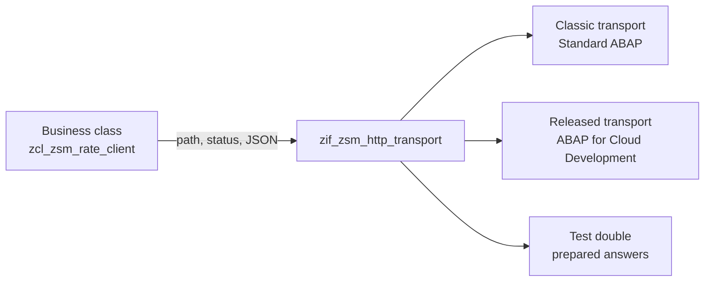

# 25 — HTTP and REST

> **Lifecycle:** `CURRENT / RECOMMENDED`. Keeping HTTP behind an interface, taking every address and credential from a destination, and the released client and service APIs (`IF_WEB_HTTP_CLIENT`, `IF_HTTP_SERVICE_EXTENSION`) are the current way in every language version. The classic HTTP client (`CL_HTTP_CLIENT`), the ICF handler interface (`IF_HTTP_EXTENSION`) and the classic REST library are `CLASSIC BUT STILL RELEVANT` and labelled where they appear. See [21-Classic-vs-Modern-ABAP](../21-Classic-vs-Modern-ABAP/README.md).

## 📖 Introduction

ABAP takes part in HTTP in two directions:

- **Outbound** — a program calls a service of another system: a REST API of a partner, a cloud service, another SAP system.
- **Inbound** — another system calls a service that your ABAP code provides.

Most of these services exchange JSON. This chapter covers both directions, JSON in both directions, and what keeps HTTP code safe and testable:

- the design: HTTP behind an interface, as in [24-Mail](../24-Mail/README.md);
- calling a service with the classic client (Standard ABAP) and with the released client (ABAP for Cloud Development);
- destinations, credentials and CSRF tokens;
- JSON with `/UI2/CL_JSON` and with `CALL TRANSFORMATION`;
- providing a service: an ICF handler (Standard ABAP) and an HTTP service (ABAP for Cloud Development);
- security in handlers, exceptions, status codes and logging;
- testing without a single network call.

OData services are not covered here. Gateway services are the subject of [GWGuide](https://github.com/serhatmercan/GWGuide); RAP-based services belong to a future RAPGuide. A reusable REST client or handler component belongs to the future ABAP-Cookbook; this chapter describes its design and does not build it.

## 🗺️ Standard ABAP and ABAP for Cloud Development at a Glance

| Topic | Standard ABAP | ABAP for Cloud Development |
|---|---|---|
| Client API | `CL_HTTP_CLIENT` / `IF_HTTP_CLIENT` (classic) | `CL_WEB_HTTP_CLIENT_MANAGER` / `IF_WEB_HTTP_CLIENT` (released) |
| Where the target is defined | HTTP destination in `SM59` (type G for an external server, type H for an ABAP system) | Communication arrangement for an own outbound communication scenario; the code gets it from `CL_HTTP_DESTINATION_PROVIDER` |
| Inbound handler | Class implementing `IF_HTTP_EXTENSION`, in the handler list of an `SICF` service | Class implementing `IF_HTTP_SERVICE_EXTENSION`, named by an HTTP service object |
| JSON | `/UI2/CL_JSON`, `CALL TRANSFORMATION id` with an sXML JSON writer | the same two (both released); `XCO_CP_JSON` as a further released option |
| Exceptions of the API | Classic exceptions (`EXCEPTIONS`, `sy-subrc`) | `CX_WEB_HTTP_CLIENT_ERROR`, `CX_HTTP_DEST_PROVIDER_ERROR` (`CX_STATIC_CHECK`); `CX_WEB_MESSAGE_ERROR` (`CX_DYNAMIC_CHECK`) |
| Release state | — | The classic `IF_HTTP_CLIENT`, `IF_HTTP_REQUEST`, `IF_HTTP_RESPONSE` and `CL_HTTP_UTILITY` are classified "not to be released", with the `IF_WEB_HTTP_*` objects and `CL_WEB_HTTP_UTILITY` as successors |

> ⚠️ **VERSION-DEPENDENT: the released HTTP APIs in Standard ABAP.** On the on-premise system used for this chapter, `CL_WEB_HTTP_CLIENT_MANAGER` and `IF_HTTP_SERVICE_EXTENSION` existed, but `CL_HTTP_DESTINATION_PROVIDER` was not found, so the cloud transport (E2) was not activated there. Check your release, and see the [ABAP Keyword Documentation](https://help.sap.com/doc/abapdocu_latest_index_htm/latest/en-US/index.htm) for language versions.

## 🧱 Design: Keep HTTP Behind an Interface

The pattern is the one from [24-Mail](../24-Mail/README.md#-design-compose-the-mail-send-it-through-an-interface):

- **What to ask and how to read the answer** — the path, the JSON format, which status codes count as success — is business logic. It lives in your own class.
- **How the request travels** — which client API, which destination — depends on the language version. It lives in a transport class behind an interface ([Rule 5.4](../docs/ABAP-Development-Rules.md#54-depend-on-interfaces-and-receive-dependencies-through-the-constructor)).



The transport raises an exception only when no answer arrives. An answer with an error status is still an answer, and the business class decides what it means.

**Example E4 — the contract and the business class.** Target: Standard ABAP and ABAP for Cloud Development. Three objects: the exception class, the transport interface and the business class. The exception class carries the HTTP status; in a real system it inherits from the team's root of checked exceptions ([Rule 6.2](../docs/ABAP-Development-Rules.md#62-build-your-own-exception-hierarchy-below-zcx_zsm_)), here from `CX_STATIC_CHECK`, so the example stands alone.

```abap
"! Raised when an HTTP call fails: no connection, or an answer the
"! caller cannot use. STATUS_CODE holds the HTTP status if there was
"! one; the cause from the HTTP API travels as PREVIOUS.
CLASS zcx_zsm_http_failed DEFINITION
  PUBLIC
  INHERITING FROM cx_static_check
  FINAL
  CREATE PUBLIC.

  PUBLIC SECTION.
    DATA status_code TYPE i READ-ONLY.

    METHODS constructor
      IMPORTING textid      LIKE textid OPTIONAL
                previous    LIKE previous OPTIONAL
                status_code TYPE i OPTIONAL.
ENDCLASS.


CLASS zcx_zsm_http_failed IMPLEMENTATION.
  METHOD constructor.
    super->constructor( textid   = textid
                        previous = previous ).
    me->status_code = status_code.
  ENDMETHOD.
ENDCLASS.
```

```abap
"! Sends HTTP requests to one configured service. Implementations
"! wrap one HTTP client API; they raise only when no answer arrives.
INTERFACE zif_zsm_http_transport PUBLIC.
  TYPES: BEGIN OF response,
           status_code TYPE i,
           body        TYPE string,
         END OF response.

  "! Sends a GET request for a path below the configured service
  METHODS get
    IMPORTING path          TYPE string
    RETURNING VALUE(result) TYPE response
    RAISING   zcx_zsm_http_failed.
ENDINTERFACE.
```

```abap
"! Reads an exchange rate from a REST service. It knows the path and
"! the JSON format of the service, not the HTTP client API.
CLASS zcl_zsm_rate_client DEFINITION PUBLIC FINAL CREATE PUBLIC.
  PUBLIC SECTION.
    TYPES currency_code TYPE c LENGTH 3.

    TYPES: BEGIN OF rate,
             currency    TYPE currency_code,
             rate        TYPE decfloat34,
             rate_source TYPE string,
           END OF rate.

    METHODS constructor
      IMPORTING transport TYPE REF TO zif_zsm_http_transport.

    "! Reads the rate of one currency; raises for every answer but 200
    METHODS rate_for
      IMPORTING currency      TYPE currency_code
      RETURNING VALUE(result) TYPE rate
      RAISING   zcx_zsm_http_failed.

  PRIVATE SECTION.
    CONSTANTS status_ok TYPE i VALUE 200.

    DATA transport TYPE REF TO zif_zsm_http_transport.
ENDCLASS.


CLASS zcl_zsm_rate_client IMPLEMENTATION.
  METHOD constructor.
    me->transport = transport.
  ENDMETHOD.

  METHOD rate_for.
    " Only three capital letters may become part of the path
    IF NOT matches( val = currency pcre = `[A-Z]{3}` ).
      RAISE EXCEPTION NEW zcx_zsm_http_failed( ).
    ENDIF.

    DATA(response) = transport->get( |/rates/{ currency }| ).
    IF response-status_code <> status_ok.
      RAISE EXCEPTION NEW zcx_zsm_http_failed( status_code = response-status_code ).
    ENDIF.

    " camel_case maps rate_source to the JSON name rateSource
    /ui2/cl_json=>deserialize( EXPORTING json        = response-body
                                         pretty_name = /ui2/cl_json=>pretty_mode-camel_case
                               CHANGING  data        = result ).
  ENDMETHOD.
ENDCLASS.
```

The business class validates its input before anything reaches the path ([Rule 8.4](../docs/ABAP-Development-Rules.md#84-build-dynamic-sql-and-other-dynamic-tokens-only-from-validated-input)): a value such as `../` never becomes part of a URL.

> 💡 **The future reusable component.** A shared REST component would add what this example leaves out: a factory that reads the destination name from configuration, POST and PUT with a JSON body, CSRF handling, retries, and logging of every call. Its public part stays an interface like `zif_zsm_http_transport`, so callers and tests do not change.

## 📤 Calling an HTTP Service in Standard ABAP

> **Lifecycle:** `CLASSIC BUT STILL RELEVANT`. `CL_HTTP_CLIENT` is what existing Standard ABAP code uses. SAP names `IF_WEB_HTTP_CLIENT` as the successor of `IF_HTTP_CLIENT`; see the at-a-glance section for its availability.

The classic client works in five steps:

1. **Create the client from a destination:** `cl_http_client=>create_by_destination( )` with the name of an HTTP destination from `SM59`. The destination holds host, port, path prefix, logon and certificate settings. Its errors are classic exceptions, among them `destination_not_found` and `destination_no_authority`.
2. **Build the request:** `client->request` is an `IF_HTTP_REQUEST`. Set the method (`set_method( )`), the path (`cl_http_utility=>set_request_uri( )`), header fields (`set_header_field( )`), and for a body the content type and `set_cdata( )` (text) or `set_data( )` (binary).
3. **Send:** `client->send( )`, with an optional `timeout`. **[verify: the unit and default of the `timeout` parameter of `send` in your release]**
4. **Receive:** `client->receive( )`. Both methods report failures through classic exceptions such as `http_communication_failure`; `client->get_last_error( )` returns code and message.
5. **Read the answer and close:** `client->response->get_status( )` returns code and reason; `get_cdata( )` or `get_data( )` the body; `client->close( )` closes the connection.

**Example E1 — the classic transport.** Target: Standard ABAP. It implements `zif_zsm_http_transport` from E4.

```abap
"! Sends HTTP requests with the classic client (Standard ABAP). Host,
"! logon and certificates come from the HTTP destination in SM59.
CLASS zcl_zsm_icf_http_transport DEFINITION PUBLIC FINAL CREATE PUBLIC.
  PUBLIC SECTION.
    INTERFACES zif_zsm_http_transport.

    "! @parameter destination | HTTP destination (type G), read from configuration
    METHODS constructor
      IMPORTING destination TYPE rfcdest.

  PRIVATE SECTION.
    CONSTANTS timeout TYPE i VALUE 30.

    DATA destination TYPE rfcdest.
ENDCLASS.


CLASS zcl_zsm_icf_http_transport IMPLEMENTATION.
  METHOD constructor.
    me->destination = destination.
  ENDMETHOD.

  METHOD zif_zsm_http_transport~get.
    cl_http_client=>create_by_destination( EXPORTING  destination = destination
                                           IMPORTING  client      = DATA(client)
                                           EXCEPTIONS OTHERS      = 1 ).
    IF sy-subrc <> 0.
      RAISE EXCEPTION NEW zcx_zsm_http_failed( ).
    ENDIF.

    client->request->set_method( if_http_request=>co_request_method_get ).
    cl_http_utility=>set_request_uri( request = client->request
                                      uri     = path ).

    client->send( EXPORTING  timeout = timeout
                  EXCEPTIONS OTHERS  = 1 ).
    IF sy-subrc = 0.
      client->receive( EXCEPTIONS OTHERS = 1 ).
    ENDIF.
    IF sy-subrc <> 0.
      " No answer arrived; the HTTP status of the service is not known
      client->close( EXCEPTIONS OTHERS = 1 ).
      RAISE EXCEPTION NEW zcx_zsm_http_failed( ).
    ENDIF.

    client->response->get_status( IMPORTING code = result-status_code ).
    result-body = client->response->get_cdata( ).
    client->close( EXCEPTIONS OTHERS = 1 ).
  ENDMETHOD.
ENDCLASS.
```

The classic exceptions are turned into `zcx_zsm_http_failed` at this boundary ([Rule 6.9](../docs/ABAP-Development-Rules.md#69-turn-sy-subrc-and-bapi-return-tables-into-exceptions-at-the-boundary)). A production version would also pass on the code and message of `get_last_error( )` to the log.

`cl_http_client=>create_by_url( )` creates a client from a URL instead, and also accepts a proxy user and password as parameters. That puts the target and possibly credentials into code ([Rule 8.5](../docs/ABAP-Development-Rules.md#85-never-hard-code-credentials-hosts-or-destinations)):

> 📝 **Contextual snippet** — a counter-example; not activated.

```abap
" ❌ the host is in the code and travels with every transport
cl_http_client=>create_by_url( EXPORTING  url    = 'https://<host>/rates'
                               IMPORTING  client = DATA(client)
                               EXCEPTIONS OTHERS = 1 ).
```

## ☁️ Calling an HTTP Service in ABAP for Cloud Development

> **Lifecycle:** `ABAP CLOUD / MODERN CONTEXT`. `CL_WEB_HTTP_CLIENT_MANAGER`, `IF_WEB_HTTP_CLIENT`, `IF_WEB_HTTP_REQUEST`, `IF_WEB_HTTP_RESPONSE`, `CL_HTTP_DESTINATION_PROVIDER` and their exceptions are released for ABAP for Cloud Development.

The released client separates the target from the client:

1. **Get the destination:** `cl_http_destination_provider=>create_by_comm_arrangement( )` takes the communication scenario and optionally the outbound service and the communication system. It returns an `IF_HTTP_DESTINATION`. The class has further factories: `create_by_cloud_destination( )` for the destination service of SAP BTP, and `create_by_url( )`, which SAP's documentation describes as suitable only for public services and tests.
2. **Create the client:** `cl_web_http_client_manager=>create_by_http_destination( )`.
3. **Build the request:** `client->get_http_request( )` returns an `IF_WEB_HTTP_REQUEST` with `set_uri_path( )`, `set_header_field( )`, `set_content_type( )` and `set_text( )` / `set_binary( )`.
4. **Execute:** `client->execute( )` takes the method as a value of the enumeration `if_web_http_client=>method` (`get`, `post`, `put`, `patch`, `delete` and others) and an optional timeout (`i_timeout`, default 0). It returns the response. **[verify: the unit of `i_timeout`]**
5. **Read the answer and close:** `response->get_status( )` returns a structure with `code` and `reason`; `get_text( )` or `get_binary( )` the body; `client->close( )`.

**Example E2 — the released transport.** Target: ABAP for Cloud Development. It implements `zif_zsm_http_transport` from E4.

```abap
"! Sends HTTP requests with the released client (ABAP for Cloud
"! Development). Host and logon come from the communication arrangement.
CLASS zcl_zsm_web_http_transport DEFINITION PUBLIC FINAL CREATE PUBLIC.
  PUBLIC SECTION.
    INTERFACES zif_zsm_http_transport.

    "! @parameter comm_scenario | Own outbound communication scenario, read from configuration
    METHODS constructor
      IMPORTING comm_scenario TYPE if_com_management=>ty_cscn_id.

  PRIVATE SECTION.
    CONSTANTS timeout TYPE i VALUE 30.

    DATA comm_scenario TYPE if_com_management=>ty_cscn_id.
ENDCLASS.


CLASS zcl_zsm_web_http_transport IMPLEMENTATION.
  METHOD constructor.
    me->comm_scenario = comm_scenario.
  ENDMETHOD.

  METHOD zif_zsm_http_transport~get.
    TRY.
        DATA(destination) = cl_http_destination_provider=>create_by_comm_arrangement(
                                comm_scenario = comm_scenario ).
        DATA(client) = cl_web_http_client_manager=>create_by_http_destination( destination ).

        client->get_http_request( )->set_uri_path( path ).
        DATA(response) = client->execute( i_method  = if_web_http_client=>get
                                          i_timeout = timeout ).

        result = VALUE #( status_code = response->get_status( )-code
                          body        = response->get_text( ) ).
        client->close( ).

      CATCH cx_http_dest_provider_error cx_web_http_client_error cx_web_message_error INTO DATA(error).
        RAISE EXCEPTION NEW zcx_zsm_http_failed( previous = error ).
    ENDTRY.
  ENDMETHOD.
ENDCLASS.
```

**What the system needs.** According to SAP's documentation, the developer creates an outbound service of type HTTP, adds it to an own communication scenario and publishes the scenario. An administrator then creates the communication system and the communication arrangement, which hold host and logon. `create_by_comm_arrangement( )` cannot be used for communication scenarios delivered by SAP.

> ⚠️ **VERSION-DEPENDENT: communication targets.** Newer SAP documentation recommends communication targets with application destinations for outbound HTTP and lists communication arrangements among the other approaches. **[verify: the API for communication targets in your release]**

## 🔐 Destinations, Credentials and Tokens

Everything that identifies or authenticates the target lives outside the code ([Rule 8.5](../docs/ABAP-Development-Rules.md#85-never-hard-code-credentials-hosts-or-destinations)):

| What | Standard ABAP | ABAP for Cloud Development |
|---|---|---|
| Host, port, path prefix | HTTP destination in `SM59` | Communication system |
| User and password, certificates, OAuth settings | HTTP destination (logon and security settings) | Communication arrangement and system |
| The name the code uses | Destination name from configuration | Communication scenario ID from configuration |

The code never contains a URL, a user, a password, an API key or a bearer token. A token that a service requires is obtained through the destination's logon settings (for example OAuth), not by code that stores it.

**CSRF tokens.** SAP services that change data — for example Gateway services and ABAP HTTP services that check CSRF — require a token with every modifying request. According to SAP's documentation:

- the client sends a non-modifying request, such as `GET`, with the header field `X-CSRF-Token` set to `Fetch`;
- the service returns the token in the `X-CSRF-Token` response header, together with a session cookie that must be sent back;
- every modifying request carries the token in `X-CSRF-Token`; a failed check answers with status 403;
- tokens are only issued after authentication.

With the classic client, enable cookies on the client (`propertytype_accept_cookie`), fetch the token with a GET, and set the header field on the next request of the same client. The released client has a method for it: `client->set_csrf_token( )` sends a `HEAD` request and sets the fetched token for the following request.

> ⚠️ **A CSRF token is not a password, but it is not log data either.** Do not write tokens, cookies or `Authorization` headers to a log ([Rule 8.8](../docs/ABAP-Development-Rules.md#88-log-no-secrets-and-no-personal-data-beyond-what-the-purpose-needs)).

## 🧾 JSON

**`/UI2/CL_JSON`** converts ABAP data to JSON and back. It exists in both versions, and SAP's list of released objects for the SAP BTP ABAP environment lists it as released; SAP's object classification also lists it as a classic API.

| Method | Purpose |
|---|---|
| `serialize( data = … )` | ABAP data → JSON string. Optional parameters include `pretty_name` (name mapping), `name_mappings` (explicit names), `compress` and `ts_as_iso8601`; see the class documentation for their effect |
| `deserialize( EXPORTING json = … CHANGING data = … )` | JSON string (or `jsonx` as `xstring`) → ABAP data, with the same mapping options |

Name mapping matters, because ABAP names are upper case with underscores and most APIs use camelCase. `pretty_name = /ui2/cl_json=>pretty_mode-camel_case` maps `rate_source` to `rateSource` in both directions — E4 relies on it, and its test proves it. Other modes are `low_case`, `pascal_case` and `user` (explicit mappings via `name_mappings`).

**`CALL TRANSFORMATION id`** is the language's own route. Serialized into a JSON writer, the identity transformation produces asJSON, the canonical JSON format of ABAP data, and it expects asJSON when it deserializes.

> 📝 **Contextual snippet** — `rate` is a structure of type `zcl_zsm_rate_client=>rate`; not activated.

```abap
DATA(writer) = cl_sxml_string_writer=>create( type = if_sxml=>co_xt_json ).
CALL TRANSFORMATION id SOURCE rate = rate
                       RESULT XML writer.
" The writer returns UTF-8 bytes
DATA(json) = cl_abap_conv_codepage=>create_in( )->convert( writer->get_output( ) ).
```

According to the ABAP Keyword Documentation, the names of the data roots (`rate` above) appear in upper case in asJSON. That makes `CALL TRANSFORMATION id` a good choice when both sides are ABAP, and `/UI2/CL_JSON` the easier one for an external API with its own naming. **[verify: the case of structure component names in asJSON]**

`XCO_CP_JSON` is a further released JSON API for ABAP for Cloud Development; it is not used in this chapter.

> ⚠️ **Never build JSON by string concatenation.** A quote or backslash in the data breaks the document or changes its structure. Serializers escape the data for you ([Rule 8.4](../docs/ABAP-Development-Rules.md#84-build-dynamic-sql-and-other-dynamic-tokens-only-from-validated-input)).

## 📥 Providing an HTTP Service

**Standard ABAP — an ICF handler.** A handler is a class that implements `IF_HTTP_EXTENSION` with its method `handle_request( server )`. `server->request` and `server->response` give access to the request and the response. In transaction `SICF`, a service node lists one or more handler classes in its handler list; the attribute `flow_rc` of the interface controls how processing continues with the other handlers of the list. New services are inactive until they are activated, and an active service can be reached over HTTP, so access must be restricted. Creating and activating `SICF` services is an administrative step, not part of this chapter's runs.

**ABAP for Cloud Development — an HTTP service.** An HTTP service is a repository object. Creating it creates its handler class, which implements `IF_HTTP_SERVICE_EXTENSION` with `handle_request( request, response )`. To make it reachable, the generated inbound service is added to a communication scenario, which is published; an administrator creates the communication arrangement.

**Example E3 — two handlers for the same service.** `zcl_zsm_rates_icf_handler` targets Standard ABAP; `zcl_zsm_rates_http_service` targets ABAP for Cloud Development and was also activated in Standard ABAP, where the interface exists (VERSION-DEPENDENT). Both answer `GET …?currency=EUR` with the rate as JSON.

```abap
"! Answers GET requests for one exchange rate as JSON (Standard ABAP,
"! ICF). Becomes reachable only through an active SICF service whose
"! handler list names this class.
CLASS zcl_zsm_rates_icf_handler DEFINITION PUBLIC FINAL CREATE PUBLIC.
  PUBLIC SECTION.
    INTERFACES if_http_extension.

  PRIVATE SECTION.
    CONSTANTS: BEGIN OF status,
                 ok          TYPE i VALUE 200,
                 bad_request TYPE i VALUE 400,
               END OF status.

    METHODS read_rate
      IMPORTING currency      TYPE zcl_zsm_rate_client=>currency_code
      RETURNING VALUE(result) TYPE zcl_zsm_rate_client=>rate.
ENDCLASS.


CLASS zcl_zsm_rates_icf_handler IMPLEMENTATION.
  METHOD if_http_extension~handle_request.
    " Validate first: only three capital letters are a currency
    DATA(currency) = to_upper( server->request->get_form_field( `currency` ) ).
    IF NOT matches( val = currency pcre = `[A-Z]{3}` ).
      server->response->set_status( code   = status-bad_request
                                    reason = `Bad Request` ).
      RETURN.
    ENDIF.

    " >>> Authorization check for reading exchange rates belongs here
    "     (Rules 8.2, 8.13); answer 403 when it fails.

    server->response->set_content_type( `application/json` ).
    server->response->set_cdata( /ui2/cl_json=>serialize(
                                     data        = read_rate( CONV #( currency ) )
                                     pretty_name = /ui2/cl_json=>pretty_mode-camel_case ) ).
    server->response->set_status( code   = status-ok
                                  reason = `OK` ).
  ENDMETHOD.

  METHOD read_rate.
    " >>> Reading the rate from the application's data belongs here
    result = VALUE #( currency = currency ).
  ENDMETHOD.
ENDCLASS.
```

```abap
"! Answers GET requests for one exchange rate as JSON with the released
"! HTTP service interface. Becomes reachable only through an HTTP
"! service object that names this class.
CLASS zcl_zsm_rates_http_service DEFINITION PUBLIC FINAL CREATE PUBLIC.
  PUBLIC SECTION.
    INTERFACES if_http_service_extension.

  PRIVATE SECTION.
    METHODS read_rate
      IMPORTING currency      TYPE zcl_zsm_rate_client=>currency_code
      RETURNING VALUE(result) TYPE zcl_zsm_rate_client=>rate.
ENDCLASS.


CLASS zcl_zsm_rates_http_service IMPLEMENTATION.
  METHOD if_http_service_extension~handle_request.
    " Validate first: only three capital letters are a currency
    DATA(currency) = to_upper( request->get_form_field( `currency` ) ).
    IF NOT matches( val = currency pcre = `[A-Z]{3}` ).
      response->set_status( if_web_http_status=>bad_request ).
      RETURN.
    ENDIF.

    " >>> Authorization check for reading exchange rates belongs here
    "     (Rules 8.2, 8.13); answer 403 when it fails.

    response->set_content_type( `application/json` ).
    response->set_text( /ui2/cl_json=>serialize(
                            data        = read_rate( CONV #( currency ) )
                            pretty_name = /ui2/cl_json=>pretty_mode-camel_case ) ).
    response->set_status( if_web_http_status=>ok ).
  ENDMETHOD.

  METHOD read_rate.
    " >>> Reading the rate from the application's data belongs here
    result = VALUE #( currency = currency ).
  ENDMETHOD.
ENDCLASS.
```

The two handlers differ only in how they reach the request and the response. A shared handler component would keep that difference in one thin class and put validation, authorization and the JSON answer into a class that both use — the same split as on the client side.

**A handler that changes data** — `POST`, `PUT`, `DELETE` — also checks the CSRF token of the request. According to SAP's documentation, the handler of an HTTP service in ABAP for Cloud Development can call `cl_http_service_utility=>handle_csrf( )` for this. **[verify: the CSRF handling of an ICF handler in Standard ABAP]**

**The classic REST library.**

> **Lifecycle:** `CLASSIC BUT STILL RELEVANT`. `CL_REST_HTTP_HANDLER`, `CL_REST_RESOURCE` and the router `CL_REST_ROUTER` are found in many existing services. SAP's object classification lists the library as a classic API; it is not released for ABAP for Cloud Development. New code uses a plain handler as in E3.

The library splits a service into an application class and resource classes:

- The application class inherits from `CL_REST_HTTP_HANDLER`, which implements `IF_HTTP_EXTENSION` itself, and redefines `get_root_handler( )` (from `IF_REST_APPLICATION`). It returns a router that maps URI templates to resource classes with `attach( iv_template = … iv_handler_class = … )`.
- Each resource class inherits from `CL_REST_RESOURCE` and redefines the methods of `IF_REST_RESOURCE` it supports, such as `get` and `post`. The protected attributes `mo_request` and `mo_response` give access to the request and the response.

> 📝 **Contextual snippet** — the method bodies of an application class and a resource class of the classic REST library; `zcl_zsm_rate_resource` is a placeholder resource class, and `rates` holds the data the resource returns. Not activated; the class, method, attribute and constant names were read from the system.

```abap
" Application class, inheriting from cl_rest_http_handler
METHOD if_rest_application~get_root_handler.
  DATA(router) = NEW cl_rest_router( ).
  router->attach( iv_template      = '/rates'
                  iv_handler_class = 'ZCL_ZSM_RATE_RESOURCE' ).
  ro_root_handler = router.
ENDMETHOD.

" Resource class zcl_zsm_rate_resource, inheriting from cl_rest_resource
METHOD if_rest_resource~get.
  DATA(entity) = mo_response->create_entity( ).
  entity->set_content_type( if_rest_media_type=>gc_appl_json ).
  entity->set_string_data( /ui2/cl_json=>serialize( data = rates ) ).
  mo_response->set_status( cl_rest_status_code=>gc_success_ok ).
ENDMETHOD.
```

## 🛡️ Security in Handlers

A handler is an entry point into the system, like an RFC function module ([Rule 8.10](../docs/ABAP-Development-Rules.md#810-check-business-authorizations-at-every-rfc-entry-point)). The rules for it ([Rule 8.13](../docs/ABAP-Development-Rules.md#813-check-business-authorizations-in-every-http-handler-and-store-no-logon-data-in-a-service)):

- **Check the business authorization in the handler.** The logon to the service decides who may call it, not which data the caller may read or change. The handler checks the authorization for the data before it reads or changes it ([Rule 8.1](../docs/ABAP-Development-Rules.md#81-check-authorization-wherever-business-data-is-read-or-changed-and-evaluate-sy-subrc)); E3 marks the place ([Rule 8.2](../docs/ABAP-Development-Rules.md#82-in-guide-examples-mark-where-the-check-belongs-never-invent-an-authorization-object)).
- **Store no logon data in a service.** According to SAP's documentation, a user and password stored in the logon data of an `SICF` node apply to that node and all nodes below it: requests then run as that user without any logon. Every caller acts with that user's authorizations, and an authorization check can no longer tell callers apart.
- **Validate every input** — query parameters, path segments, headers and the body — before it is used ([Rule 8.4](../docs/ABAP-Development-Rules.md#84-build-dynamic-sql-and-other-dynamic-tokens-only-from-validated-input)). E3 accepts exactly three capital letters and answers 400 to anything else.
- **Answer without internal details.** A status code and a short neutral message; no exception texts, stack traces, table names or SQL.
- **Log identifiers, not payloads** — and no tokens, cookies or `Authorization` headers ([Rule 8.8](../docs/ABAP-Development-Rules.md#88-log-no-secrets-and-no-personal-data-beyond-what-the-purpose-needs)).

## 🧯 Exceptions, Status Codes and Logging

Three kinds of failure reach an HTTP caller, and the design handles each in one place:

| Failure | Where it shows | Handled by |
|---|---|---|
| No answer: destination missing, no connection, timeout | Classic exceptions (Standard ABAP) or `CX_WEB_HTTP_CLIENT_ERROR` / `CX_HTTP_DEST_PROVIDER_ERROR` (cloud) | The transport converts it into `zcx_zsm_http_failed` with the cause as `PREVIOUS` ([Rule 6.8](../docs/ABAP-Development-Rules.md#68-keep-the-cause-when-converting-an-exception-pass-it-as-previous)) |
| An answer with an error status, such as 404 or 500 | The status code of the response | The business class, which knows which codes mean what; E4 raises `zcx_zsm_http_failed` with the status code |
| An answer that cannot be read | The JSON does not match the expected structure | The business class; check required fields after deserializing |

The released response API raises `CX_WEB_MESSAGE_ERROR` (a `CX_DYNAMIC_CHECK` exception) for problems with the message itself; E2 catches it with the others.

The caller decides what a failure means — retry later, skip, or stop — and logs it in the application log ([18-Debugging](../18-Debugging/README.md#application-log-bal)): the name of the service, the status code, an identifier of the business object. Not the body, not the URL with its parameters, not the headers ([Rule 8.8](../docs/ABAP-Development-Rules.md#88-log-no-secrets-and-no-personal-data-beyond-what-the-purpose-needs)).

To debug an inbound call, the debugger must be told to stop for requests from outside; see [23-Debugging-Troubleshooting](../23-Debugging-Troubleshooting/README.md#where-a-breakpoint-stops).

## 🧪 Testing Without Network Calls

The business class only knows `zif_zsm_http_transport`, so a test replaces the transport with a double that answers with a prepared response and records what it was asked ([Rule 10.6](../docs/ABAP-Development-Rules.md#106-replace-dependencies-with-test-doubles-through-interfaces-and-cl_abap_testdouble)). The tests then check the path, the JSON mapping, the status handling and the input validation. No request leaves the system, and no destination is needed. See [22-ABAP-Unit](../22-ABAP-Unit/README.md).

**Example E4 (continued) — the test include of `zcl_zsm_rate_client`.**

```abap
"! Test double for the transport: answers with a prepared response
"! and records the paths it was asked for, without any network call
CLASS lth_http_transport DEFINITION FINAL FOR TESTING.
  PUBLIC SECTION.
    INTERFACES zif_zsm_http_transport.

    DATA requested_paths TYPE string_table READ-ONLY.

    METHODS answer_with
      IMPORTING response TYPE zif_zsm_http_transport=>response.

  PRIVATE SECTION.
    DATA response TYPE zif_zsm_http_transport=>response.
ENDCLASS.


CLASS lth_http_transport IMPLEMENTATION.
  METHOD answer_with.
    me->response = response.
  ENDMETHOD.

  METHOD zif_zsm_http_transport~get.
    INSERT path INTO TABLE requested_paths.
    result = response.
  ENDMETHOD.
ENDCLASS.


CLASS ltc_rate_client DEFINITION FINAL FOR TESTING
  RISK LEVEL HARMLESS
  DURATION SHORT.

  PRIVATE SECTION.
    DATA cut       TYPE REF TO zcl_zsm_rate_client.
    DATA transport TYPE REF TO lth_http_transport.

    METHODS setup.
    METHODS requests_path_of_currency FOR TESTING RAISING cx_static_check.
    METHODS reads_rate_from_json FOR TESTING RAISING cx_static_check.
    METHODS raises_for_status_not_ok FOR TESTING RAISING cx_static_check.
    METHODS rejects_invalid_currency FOR TESTING RAISING cx_static_check.
ENDCLASS.


CLASS ltc_rate_client IMPLEMENTATION.
  METHOD setup.
    transport = NEW #( ).
    cut       = NEW #( transport ).
  ENDMETHOD.

  METHOD requests_path_of_currency.
    " given
    transport->answer_with( VALUE #( status_code = 200
                                     body        = `{"currency":"EUR","rate":1.25}` ) ).

    " when
    cut->rate_for( 'EUR' ).

    " then
    cl_abap_unit_assert=>assert_equals( act = transport->requested_paths
                                        exp = VALUE string_table( ( `/rates/EUR` ) ) ).
  ENDMETHOD.

  METHOD reads_rate_from_json.
    " given
    transport->answer_with(
        VALUE #( status_code = 200
                 body        = `{"currency":"EUR","rate":1.25,"rateSource":"test"}` ) ).

    " when
    DATA(rate) = cut->rate_for( 'EUR' ).

    " then
    cl_abap_unit_assert=>assert_equals(
        act = rate
        exp = VALUE zcl_zsm_rate_client=>rate( currency    = 'EUR'
                                               rate        = CONV #( '1.25' )
                                               rate_source = `test` ) ).
  ENDMETHOD.

  METHOD raises_for_status_not_ok.
    " given
    transport->answer_with( VALUE #( status_code = 404 ) ).

    TRY.
        " when
        cut->rate_for( 'EUR' ).
        cl_abap_unit_assert=>fail( msg = 'A status other than 200 must raise' ).

      CATCH zcx_zsm_http_failed INTO DATA(error).
        " then
        cl_abap_unit_assert=>assert_equals( act = error->status_code
                                            exp = 404 ).
    ENDTRY.
  ENDMETHOD.

  METHOD rejects_invalid_currency.
    TRY.
        " when: a value that would change the path
        cut->rate_for( '../' ).
        cl_abap_unit_assert=>fail( msg = 'An invalid currency must raise' ).

      CATCH zcx_zsm_http_failed.
        " then: the service was not called at all
        cl_abap_unit_assert=>assert_initial( transport->requested_paths ).
    ENDTRY.
  ENDMETHOD.
ENDCLASS.
```

The transports E1 and E2 and the handlers E3 are not unit-tested here: a transport test would need a real connection, and a handler test needs request and response objects. Keep them thin, and move what is worth testing — validation, mapping, authorization decisions — into classes behind them. **[verify: how request and response objects for a handler test can be created in your release]**

**To try it:** create E4's three objects as local objects or in a development package, paste the test include, activate, and run the class's unit tests. All four tests should pass. Then remove the `pretty_name` parameter in `rate_for` and watch `reads_rate_from_json` fail.

> 📝 **Activation record.** E4 (`zcx_zsm_http_failed`, `zif_zsm_http_transport`, `zcl_zsm_rate_client` with its test include) was activated, and its 4 test methods were run with all 4 passing, in both ABAP language versions: Standard ABAP and ABAP for Cloud Development. E1 and `zcl_zsm_rates_icf_handler` were activated in Standard ABAP. E2 was activated in ABAP for Cloud Development. `zcl_zsm_rates_http_service` was activated in both versions. E1, E2 and E3 were not run: no example made a network call, and no destination, communication arrangement or service was created.

## 🧭 Scope Note

- **OData services** — Gateway and RAP — are covered by [GWGuide](https://github.com/serhatmercan/GWGuide) and a future RAPGuide.
- **SOAP web services**, consumer and provider proxies, and the Service Consumption Model are not covered.
- **Multipart requests and file uploads** are not covered.
- **Administration** — `SM59` destinations, `SICF` services, certificates, the Internet Communication Manager, communication systems and arrangements — is described only as far as the code depends on it.
- **A reusable REST client or handler component** belongs to the future ABAP-Cookbook; this chapter describes its design.

## ✅ Best Practices

- Keep HTTP behind an interface; put path, status handling and JSON mapping into a class you can test — [Rule 5.4](../docs/ABAP-Development-Rules.md#54-depend-on-interfaces-and-receive-dependencies-through-the-constructor).
- Take host, logon and certificates from a destination or communication arrangement; the code only knows its name, read from configuration — [Rule 8.5](../docs/ABAP-Development-Rules.md#85-never-hard-code-credentials-hosts-or-destinations).
- Use the released client and service APIs in ABAP for Cloud Development, and check whether your release offers them before writing new classic code in Standard ABAP — [Rule 1.2](../docs/ABAP-Development-Rules.md#12-when-targeting-abap-for-cloud-development-use-only-released-apis), [Rule 1.3](../docs/ABAP-Development-Rules.md#13-in-standard-abap-prefer-a-released-api-over-an-unreleased-one-when-both-exist).
- Serialize and deserialize JSON with a serializer, never by hand.
- Validate every input before it becomes part of a URL or a query, on both sides — [Rule 8.4](../docs/ABAP-Development-Rules.md#84-build-dynamic-sql-and-other-dynamic-tokens-only-from-validated-input).
- Check business authorizations in every handler, and store no logon data in a service — [Rule 8.13](../docs/ABAP-Development-Rules.md#813-check-business-authorizations-in-every-http-handler-and-store-no-logon-data-in-a-service).
- Convert the API's exceptions at the transport boundary and keep the cause — [Rules 6.8](../docs/ABAP-Development-Rules.md#68-keep-the-cause-when-converting-an-exception-pass-it-as-previous) and [6.9](../docs/ABAP-Development-Rules.md#69-turn-sy-subrc-and-bapi-return-tables-into-exceptions-at-the-boundary).
- Log the service name, status and an identifier; never bodies, tokens or headers — [Rule 8.8](../docs/ABAP-Development-Rules.md#88-log-no-secrets-and-no-personal-data-beyond-what-the-purpose-needs).
- Test with a transport double; no unit test makes a network call — [Rule 10.6](../docs/ABAP-Development-Rules.md#106-replace-dependencies-with-test-doubles-through-interfaces-and-cl_abap_testdouble).

## ⚠️ Common Mistakes

- A URL, user, password or API key in the code, created with `create_by_url( )` or `authenticate( )`.
- Logon data stored in an `SICF` service, so every caller works with one user's authorizations.
- A handler that relies on the service logon and checks no business authorization.
- A service that returns its own CSRF token in the response body instead of using the header protocol.
- JSON assembled with `CONCATENATE` or string templates.
- Treating every answer as success: no check of the status code, so an error page is deserialized as data.
- Ignoring the classic exceptions of `send` and `receive`, so a broken connection ends in a short dump or in silent empty data.
- Request and response bodies written to the log, including personal data or tokens.
- An exception text or stack trace returned to the caller.
- Unit tests that call a real service, and fail whenever the network or the partner does.

## 🎤 Interview & Review Checkpoints

- Explain why the URL and the credentials of a service do not belong in the code, and where they live in Standard ABAP and in ABAP for Cloud Development.
- Walk through a call with the released client: destination, client, request, execute, status, close.
- Explain the CSRF protocol: which request fetches the token, how it is sent, and what happens without it.
- Compare `/UI2/CL_JSON` and `CALL TRANSFORMATION id` for JSON, including name mapping.
- Explain what a handler must check even when the service requires a logon, and why stored logon data is dangerous.
- Explain where a connection failure, an error status and an unreadable answer are each handled.
- Explain how you test a class that calls a REST service without calling it.

## 🖥️ Related Transaction Codes

| T-Code | Purpose |
|---|---|
| SM59 | RFC and HTTP destinations (type G: external server; type H: ABAP system) |
| SICF | ICF services: handler list, logon data, activation; external debugging |

## 🔗 Related Chapters

- [09-Modularization](../09-Modularization/README.md#-calling-a-function-module-via-rfc-destination) — RFC destinations, the other kind of `SM59` destination
- [18-Debugging](../18-Debugging/README.md) — exceptions and the application log for failed calls
- [21-Classic-vs-Modern-ABAP](../21-Classic-vs-Modern-ABAP/README.md) — where the classic and the released HTTP APIs sit in the lifecycle map
- [22-ABAP-Unit](../22-ABAP-Unit/README.md) — test doubles for the transport
- [23-Debugging-Troubleshooting](../23-Debugging-Troubleshooting/README.md) — debugging requests that come from outside
- [24-Mail](../24-Mail/README.md) — the same design for sending mail
- [26-Maintenance-Views](../26-Maintenance-Views/README.md) — the next chapter: Customizing tables and how users maintain them
- [28-Adobe-Forms](../28-Adobe-Forms/README.md) — the same design for form output
- [32-IDoc-ALE](../32-IDoc-ALE/README.md) — asynchronous document exchange as the alternative
- [34-Authorization-Checks](../34-Authorization-Checks/README.md) — the authorization check a handler performs
