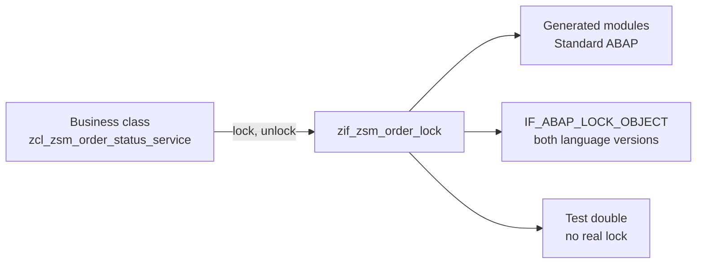

# 27 — Lock Objects and the SAP Lock Concept

> **Lifecycle:** `CURRENT / RECOMMENDED`. Lock objects in the ABAP Dictionary, a lock behind an interface, and the released lock API `IF_ABAP_LOCK_OBJECT` are the current way in every language version; in Standard ABAP the released API is `VERSION-DEPENDENT`. The generated `ENQUEUE_` and `DEQUEUE_` function modules are `CLASSIC BUT STILL RELEVANT`. Locking in RAP is `ABAP CLOUD / MODERN CONTEXT` and only named here. See [21-Classic-vs-Modern-ABAP](../21-Classic-vs-Modern-ABAP/README.md).

## 📖 Introduction

Two users open the same order. Both read status "open", both decide to release it, and both save. The second save overwrites the first without anyone noticing: a lost update. Inside one database transaction the database would prevent this, but a business transaction in SAP spans several dialog steps and several database transactions, so a database lock does not survive long enough.

The SAP lock concept closes that gap. A program asks for a logical lock on the data it is about to change, keeps it for the whole business transaction, and releases it when the work is committed or discarded. This chapter covers:

- what the lock concept protects, and what it does not;
- lock objects in the ABAP Dictionary and the function modules generated from them;
- lock modes, and the parameters that control scope, waiting and collisions;
- how locks relate to the SAP LUW, the update task and `COMMIT WORK`;
- pessimistic and optimistic locking;
- lock entries and collisions in `SM12`;
- locks in maintenance dialogs;
- the released lock API for ABAP for Cloud Development, and how RAP handles locking;
- testing code that locks, without setting a single real lock.

The SAP LUW itself is explained in [08-Open-SQL](../08-Open-SQL/README.md#-sap-luw--transaction-ownership); this chapter builds on it.

## 🗺️ Standard ABAP and ABAP for Cloud Development at a Glance

| Topic | Standard ABAP | ABAP for Cloud Development |
|---|---|---|
| Lock object | Lock object in the ABAP Dictionary (`SE11` or ADT) | Lock object in ADT |
| Call | Generated function modules `ENQUEUE_<name>` / `DEQUEUE_<name>`, or the released API where available | `CL_ABAP_LOCK_OBJECT_FACTORY=>get_instance( )` and `IF_ABAP_LOCK_OBJECT->enqueue( )` / `dequeue( )` |
| Errors | Classic exceptions `foreign_lock`, `system_failure` | `CX_ABAP_FOREIGN_LOCK`, `CX_ABAP_LOCK_FAILURE` |
| Release all locks | Function module `DEQUEUE_ALL` | `CL_ABAP_LOCK_OBJECT_FACTORY=>dequeue_all( )` |
| Lock entries | `SM12` | **[verify: how lock entries are monitored in the SAP BTP ABAP environment]** |
| RAP | — | The RAP framework locks through the behavior definition (`lock master`) |
| Release state | — | `CL_ABAP_LOCK_OBJECT_FACTORY`, `IF_ABAP_LOCK_OBJECT`, `CX_ABAP_FOREIGN_LOCK`, `CX_ABAP_LOCK_FAILURE`: released |

The release states come from SAP's list of released objects for the SAP BTP ABAP environment.

## 🔒 What the SAP Lock Concept Protects

According to the ABAP Keyword Documentation, SAP locks are set through lock objects defined in the ABAP Dictionary. The generated function modules write lock entries into a central lock table, held in the memory of a special work process. There is one lock table per AS ABAP, and it is administered in `SM12`.

Three consequences matter in practice:

- **A lock is logical, not physical.** It does not stop a program from reading or writing the table. It only stops another program that asks for a colliding lock. According to SAP's documentation, the concept works only when all programs that change the data cooperate, that is, request the lock ([Rule 7.12](../docs/ABAP-Development-Rules.md#712-protect-business-transactions-with-enqueue-locks)).
- **A lock argument is a table and a key.** It protects the rows with that key, or, with a generic argument, every row that matches it.
- **A lock outlives the dialog step.** It stays set across screens and database commits until it is released, which is what the business transaction needs.

## 🧱 Lock Objects in the ABAP Dictionary

A lock object names the tables and the key fields that one lock covers:

- **Primary table.** The table the lock is about.
- **Secondary tables.** Further tables, linked to the primary table by foreign keys, that are locked together with it.
- **Lock parameters.** The key fields that become parameters of the lock. ADT proposes the key fields of the tables.
- **Lock mode per table.** The default mode the generated modules use for each table.
- **Allow RFC.** Lets other systems call the generated modules.

The name of a lock object must begin with `E`; the naming table of the rules uses `EZSM_` ([Rule 2.6](../docs/ABAP-Development-Rules.md#26-name-development-objects-by-the-object-naming-table)). ADT allows at most 16 characters in both systems used for this chapter. Activation generates the function modules `ENQUEUE_<name>` and `DEQUEUE_<name>`.

**Example E1 — the table and its lock object.** A small order table; the lock object `EZSM_ORDER` locks one order by its key.

```abap
@EndUserText.label : 'Orders (lock example)'
@AbapCatalog.enhancement.category : #NOT_EXTENSIBLE
@AbapCatalog.tableCategory : #TRANSPARENT
@AbapCatalog.deliveryClass : #A
@AbapCatalog.dataMaintenance : #RESTRICTED
define table zsm_t_order {

  key client   : abap.clnt not null;
  key order_id : abap.char(10) not null;
  status       : abap.char(1);
  version      : abap.int4;

}
```

The lock object is a form-based object in ADT, so it has no source code. Its settings for E1:

| Setting | Value |
|---|---|
| Name | `EZSM_ORDER` |
| Primary table | `ZSM_T_ORDER`, lock mode *exclusive* (write lock, `E`) |
| Lock parameters | `CLIENT`, `ORDER_ID` (the key fields of the table) |
| Allow RFC | no |

> 📝 The field `version` is not needed for locking. It serves the optimistic check in [Pessimistic and Optimistic Locking](#-pessimistic-and-optimistic-locking).

> ⚠️ **An empty lock mode activates, but locks nothing.** If the lock mode of the primary table is left empty, the lock object still activates. The generated `ENQUEUE_` and `DEQUEUE_` modules then have no `MODE_<table>` parameter, and their body only states that no table can be locked, so a call locks nothing. ADT shows warnings for this state, but they do not stop the activation. After activating, check that the lock mode is set and that `ENQUEUE_<name>` has the parameter `MODE_<table>`. This was observed in Standard ABAP and in ABAP for Cloud Development; the warnings were seen in the ADT editor in ABAP for Cloud Development.

> ⚠️ **VERSION-DEPENDENT: the lock mode in the ABAP file format.** In the lock object's file in the ABAP file format, the lock mode reads `"exclusive"` for an empty mode as well; `exclusive` is the default of that field in the format's schema. A review of that file therefore cannot tell an empty mode from a write lock; check the generated module instead. Observed in the systems used for this chapter.

## 🎚️ Lock Modes

The mode decides which other locks a lock collides with. According to the ABAP Keyword Documentation and SAP's documentation:

| Mode | Name | Meaning |
|---|---|---|
| `E` | Write lock (exclusive) | Protects data that is about to change. The same owner can request it again; other owners collide. |
| `S` | Shared lock (read lock) | Protects data that must not change while it is being read. Several owners can hold `S` locks on the same data. |
| `X` | Exclusive, not cumulative | Like `E`, but even the same owner can request it only once. |
| `O` | Optimistic lock | Behaves like `S` at first, and can later be promoted to an exclusive lock. |

The rules for collisions follow from this:

- Two shared locks never collide.
- Locks of different owners collide in every other combination.
- Locks of the same owner are accepted together, unless one of them is `X`.

An optimistic lock `O` collides only with a foreign `E` or `X` lock. Promoting it (mode `R` in the lock API) turns it into a write lock, if it still exists and no foreign lock collides. A successful promotion removes the colliding optimistic locks of other users, so an optimistic lock can be lost. **[verify: the complete lock cumulation table in the ABAP Keyword Documentation]**

Use `E` for data you change, `S` only when a read must stay stable for a while, and leave `X` and `O` to the cases that need them.

## ⚙️ Calling the Lock: ENQUEUE_ and DEQUEUE_

> **Lifecycle:** `CLASSIC BUT STILL RELEVANT`. The generated function modules are what most existing code calls. New code wraps them behind an interface, or uses the released API.

The generated `ENQUEUE_<name>` module has these parameters (checked on a module SAP generated for one of its own lock objects):

| Parameter | Purpose |
|---|---|
| `mode_<table>` | Lock mode for that table; default from the lock object, typically `E` |
| One parameter per lock field, for example `order_id` | The value to lock; the client field defaults to the logon client |
| `x_<field>` | Locks the initial value itself instead of all values |
| `_scope` | How the lock relates to the update task (next section); default `2` |
| `_wait` | Retry when a foreign lock exists, until a time limit set by profile parameters |
| `_collect` | Collect the request and send it later together with others (function module `FLUSH_ENQUEUE`) |
| Exceptions `foreign_lock`, `system_failure` | Another owner holds a colliding lock; or the lock could not be set technically |

`DEQUEUE_<name>` has the same lock fields, `_scope` (default `3`), `_synchron` and no exceptions.

> ⚠️ **An initial lock parameter is a wildcard.** According to SAP's documentation, a lock field passed with an initial value, and without its `x_` flag, is locked generically: every value of that field. An empty order ID therefore locks every order of the client. Pass the complete key, and set the `x_` flag when an initial value is a real key ([Rule 7.18](../docs/ABAP-Development-Rules.md#718-lock-with-the-complete-key-you-are-about-to-change-pass-a-key-field-initial-only-when-a-generic-lock-is-intended)).

**Example E2 — the lock with the generated modules.**

> 📝 **Target:** Standard ABAP.

```abap
"! Locks orders with the function modules generated for EZSM_ORDER
CLASS zcl_zsm_order_lock_classic DEFINITION PUBLIC FINAL CREATE PUBLIC.
  PUBLIC SECTION.
    INTERFACES zif_zsm_order_lock.
ENDCLASS.


CLASS zcl_zsm_order_lock_classic IMPLEMENTATION.
  METHOD zif_zsm_order_lock~lock.
    " x_order_id: an initial order_id locks only that value, never all orders (Rule 7.18)
    CALL FUNCTION 'ENQUEUE_EZSM_ORDER'
      EXPORTING
        order_id       = order_id
        x_order_id     = abap_true
      EXCEPTIONS
        foreign_lock   = 1
        system_failure = 2
        OTHERS         = 3.
    IF sy-subrc <> 0.
      " USING MESSAGE keeps the lock message, which names the user holding the lock
      RAISE EXCEPTION TYPE zcx_zsm_order_lock_failed USING MESSAGE
        EXPORTING
          order_id     = order_id
          foreign_lock = xsdbool( sy-subrc = 1 ).
    ENDIF.
  ENDMETHOD.

  METHOD zif_zsm_order_lock~unlock.
    " The generated DEQUEUE module has no exceptions
    CALL FUNCTION 'DEQUEUE_EZSM_ORDER'
      EXPORTING
        order_id   = order_id
        x_order_id = abap_true.
  ENDMETHOD.
ENDCLASS.
```

The classic exceptions become a class-based exception at this boundary, with the lock message attached ([Rule 6.9](../docs/ABAP-Development-Rules.md#69-turn-sy-subrc-and-bapi-return-tables-into-exceptions-at-the-boundary)). The interface `zif_zsm_order_lock` and the exception class are part of E4.

> 📝 The interface of `ENQUEUE_EZSM_ORDER`, read in ABAP for Cloud Development after the write lock was set: the importing parameters `MODE_ZSM_T_ORDER` (type `ENQMODE`, default `'E'`), `CLIENT`, `ORDER_ID`, `X_ORDER_ID`, `_SCOPE`, `_WAIT` and `_COLLECT`, and the exceptions `FOREIGN_LOCK` and `SYSTEM_FAILURE`. E2 leaves `MODE_ZSM_T_ORDER` and `CLIENT` at their defaults. Activation does not check the parameters of a `CALL FUNCTION` with a literal name, so compare E2 with the module in `SE37` after every change to the lock object.

## ☁️ The Released Lock API

`CL_ABAP_LOCK_OBJECT_FACTORY=>get_instance( )` returns an `IF_ABAP_LOCK_OBJECT` for a lock object. The interface offers:

- `enqueue( )` with the lock modes per table (`it_table_mode`), the lock parameters as name and data reference (`it_parameter`), `_scope` (default `2`) and `_wait`. It raises `CX_ABAP_FOREIGN_LOCK` for a colliding lock and `CX_ABAP_LOCK_FAILURE` for a technical failure.
- `dequeue( )` with the same table modes and parameters, `_scope` (default `3`) and `_synchronous`. It raises only `CX_ABAP_LOCK_FAILURE`.
- Constants for the modes (`cs_mode-write_lock` for `E`, `shared_lock`, `exclusive_lock`, `optimistic_lock`, `promote_optimistic_lock` and check-only modes), for `_scope` and for `_wait`.

`CL_ABAP_LOCK_OBJECT_FACTORY=>dequeue_all( )` releases all locks of the current SAP LUW, according to its ABAP Doc. `get_instance( )` checks at runtime whether the caller may use the lock object, and raises `CX_ABAP_LOCK_FAILURE` if not.

Read in the system used for this chapter: a supplied parameter is passed as the lock argument together with its `x_` flag, so an initial value supplied here locks only that value. A parameter that is left out stays generic. The API calls the generated modules underneath.

**Example E3 — the lock with the released API.** Target: Standard ABAP and ABAP for Cloud Development.

```abap
"! Locks orders through the released lock object API
CLASS zcl_zsm_order_lock DEFINITION PUBLIC FINAL CREATE PUBLIC.
  PUBLIC SECTION.
    INTERFACES zif_zsm_order_lock.

  PRIVATE SECTION.
    CONSTANTS lock_object_name TYPE if_abap_lock_object=>tv_name VALUE 'EZSM_ORDER'.

    METHODS lock_parameters
      IMPORTING order_id      TYPE REF TO zsm_t_order-order_id
      RETURNING VALUE(result) TYPE if_abap_lock_object=>tt_parameter.
ENDCLASS.


CLASS zcl_zsm_order_lock IMPLEMENTATION.
  METHOD zif_zsm_order_lock~lock.
    TRY.
        cl_abap_lock_object_factory=>get_instance( lock_object_name )->enqueue(
            it_parameter = lock_parameters( REF #( order_id ) ) ).

      CATCH cx_abap_foreign_lock INTO DATA(foreign_lock).
        RAISE EXCEPTION NEW zcx_zsm_order_lock_failed( previous     = foreign_lock
                                                       order_id     = order_id
                                                       foreign_lock = abap_true ).
      CATCH cx_abap_lock_failure INTO DATA(lock_failure).
        RAISE EXCEPTION NEW zcx_zsm_order_lock_failed( previous = lock_failure
                                                       order_id = order_id ).
    ENDTRY.
  ENDMETHOD.

  METHOD zif_zsm_order_lock~unlock.
    TRY.
        cl_abap_lock_object_factory=>get_instance( lock_object_name )->dequeue(
            it_parameter = lock_parameters( REF #( order_id ) ) ).

      CATCH cx_abap_lock_failure INTO DATA(lock_failure).
        RAISE EXCEPTION NEW zcx_zsm_order_lock_failed( previous = lock_failure
                                                       order_id = order_id ).
    ENDTRY.
  ENDMETHOD.

  METHOD lock_parameters.
    " A supplied parameter is the lock argument even when it is initial;
    " the client is filled by the API
    result = VALUE #( ( name = 'ORDER_ID' value = order_id ) ).
  ENDMETHOD.
ENDCLASS.
```

Both API exceptions keep their cause as `PREVIOUS` ([Rule 6.8](../docs/ABAP-Development-Rules.md#68-keep-the-cause-when-converting-an-exception-pass-it-as-previous)).

> ⚠️ **VERSION-DEPENDENT: the released lock API in Standard ABAP.** `CL_ABAP_LOCK_OBJECT_FACTORY` existed on the on-premise system used for this chapter, and E3 activated there. Check your release ([Rule 1.3](../docs/ABAP-Development-Rules.md#13-in-standard-abap-prefer-a-released-api-over-an-unreleased-one-when-both-exist)).

## 🔁 Locks, the SAP LUW and COMMIT WORK

The pattern is the one from [Rule 7.12](../docs/ABAP-Development-Rules.md#712-protect-business-transactions-with-enqueue-locks): lock before you read data you intend to change, release after the commit or the rollback, and report a foreign lock as a business message.

The parameter `_scope` decides how a lock relates to the SAP LUW. According to the ABAP Keyword Documentation and SAP's documentation:

| `_scope` | Meaning |
|---|---|
| `1` | The lock belongs to the program only, not to the SAP LUW. It ends with `DEQUEUE` or with the end of the program. |
| `2` | The lock belongs to the SAP LUW and is passed to the update. Default for `ENQUEUE`. |
| `3` | The lock must be released both by the program and by the update. Default for `DEQUEUE`. |

With `_scope = 2`, when at least one update function module was registered with `IN UPDATE TASK`, `COMMIT WORK` or `ROLLBACK WORK` ends the lock together with the SAP LUW. With `COMMIT WORK`, the update releases it after the update function modules have run, possibly after the program itself has ended. The value of `_scope` in `DEQUEUE` must not be smaller than in the matching `ENQUEUE`.

> ⚠️ **Without an update function module, do not rely on `COMMIT WORK` to release a `_scope = 2` lock.** The documentation describes the release at commit only for the case with registered update function modules. Release the lock yourself after the commit. **[verify: what happens to a `_scope = 2` lock when no update function module is registered]**

The commit belongs to the transaction owner, not to the code that locks ([Rule 7.10](../docs/ABAP-Development-Rules.md#710-let-the-top-level-caller-own-the-transaction-reusable-units-never-commit-work)). A locking method that commits on its own ends the caller's SAP LUW, and with `AND WAIT` it also blocks until the update is done ([Rule 7.14](../docs/ABAP-Development-Rules.md#714-use-commit-work-and-wait-only-when-the-next-step-depends-on-the-update)).

**BAPIs** set and handle their own locks. They never commit; the caller ends the transaction with `BAPI_TRANSACTION_COMMIT` or `BAPI_TRANSACTION_ROLLBACK` ([15-BAPIs](../15-BAPIs/README.md#-commit--rollback)). SAP's BAPI guidelines say that locks must be removed when no `COMMIT WORK` follows a BAPI call. **[verify: whether `BAPI_TRANSACTION_COMMIT` and `BAPI_TRANSACTION_ROLLBACK` release the locks of the BAPI]**

## 🧩 Design: The Lock Behind an Interface

Business code should not know which lock API it uses. A small interface hides it, as the transport interfaces do in [24-Mail](../24-Mail/README.md#-design-compose-the-mail-send-it-through-an-interface) and [25-HTTP-REST](../25-HTTP-REST/README.md#-design-keep-http-behind-an-interface):



**Example E4 — the contract and the service.** Target: Standard ABAP and ABAP for Cloud Development. The exception classes inherit from `CX_STATIC_CHECK` so the example stands alone; in a real system they inherit from the team's root ([Rule 6.2](../docs/ABAP-Development-Rules.md#62-build-your-own-exception-hierarchy-below-zcx_zsm_)). `zcx_zsm_order_lock_failed` implements `IF_T100_DYN_MSG`, so E2 can attach the lock message with `USING MESSAGE`.

```abap
"! Raised when an order cannot be locked or unlocked. FOREIGN_LOCK is
"! abap_true when another user holds the lock; the message names them
"! where the lock API provides one.
CLASS zcx_zsm_order_lock_failed DEFINITION
  PUBLIC
  INHERITING FROM cx_static_check
  FINAL
  CREATE PUBLIC.

  PUBLIC SECTION.
    INTERFACES if_t100_message.
    INTERFACES if_t100_dyn_msg.

    DATA order_id     TYPE zsm_t_order-order_id READ-ONLY.
    DATA foreign_lock TYPE abap_bool READ-ONLY.

    METHODS constructor
      IMPORTING textid       LIKE if_t100_message=>t100key OPTIONAL
                previous     LIKE previous OPTIONAL
                order_id     TYPE zsm_t_order-order_id OPTIONAL
                foreign_lock TYPE abap_bool OPTIONAL.
ENDCLASS.


CLASS zcx_zsm_order_lock_failed IMPLEMENTATION.
  METHOD constructor ##ADT_SUPPRESS_GENERATION.
    super->constructor( previous = previous ).
    CLEAR me->textid.
    IF textid IS INITIAL.
      if_t100_message~t100key = if_t100_message=>default_textid.
    ELSE.
      if_t100_message~t100key = textid.
    ENDIF.
    me->order_id     = order_id.
    me->foreign_lock = foreign_lock.
  ENDMETHOD.
ENDCLASS.
```

```abap
"! Raised when an order does not exist. ORDER_ID names the order.
CLASS zcx_zsm_order_not_found DEFINITION
  PUBLIC
  INHERITING FROM cx_static_check
  FINAL
  CREATE PUBLIC.

  PUBLIC SECTION.
    DATA order_id TYPE zsm_t_order-order_id READ-ONLY.

    METHODS constructor
      IMPORTING textid   LIKE textid OPTIONAL
                previous LIKE previous OPTIONAL
                order_id TYPE zsm_t_order-order_id OPTIONAL.
ENDCLASS.


CLASS zcx_zsm_order_not_found IMPLEMENTATION.
  METHOD constructor.
    super->constructor( textid   = textid
                        previous = previous ).
    me->order_id = order_id.
  ENDMETHOD.
ENDCLASS.
```

```abap
"! Sets and releases the SAP lock of one order. Implementations wrap
"! one lock API; business code knows only this interface.
INTERFACE zif_zsm_order_lock PUBLIC.
  "! Locks one order for changing
  "! @parameter order_id | Order to lock
  "! @raising zcx_zsm_order_lock_failed | Another user holds the lock, or locking failed
  METHODS lock
    IMPORTING order_id TYPE zsm_t_order-order_id
    RAISING   zcx_zsm_order_lock_failed.

  "! Releases the lock of one order
  "! @parameter order_id | Order to unlock
  "! @raising zcx_zsm_order_lock_failed | Unlocking was technically not possible
  METHODS unlock
    IMPORTING order_id TYPE zsm_t_order-order_id
    RAISING   zcx_zsm_order_lock_failed.
ENDINTERFACE.
```

```abap
"! Changes the status of orders. change_status locks the order first
"! (pessimistic); change_status_if_unchanged holds no lock and checks the
"! version when it writes (optimistic). Neither method commits.
CLASS zcl_zsm_order_status_service DEFINITION PUBLIC FINAL CREATE PUBLIC.
  PUBLIC SECTION.
    TYPES order_id TYPE zsm_t_order-order_id.
    TYPES status   TYPE zsm_t_order-status.
    TYPES version  TYPE zsm_t_order-version.

    METHODS constructor
      IMPORTING lock TYPE REF TO zif_zsm_order_lock.

    "! Locks the order and changes its status. The lock stays set; the
    "! caller commits or rolls back and then unlocks.
    "! @parameter order_id | Order to change
    "! @parameter new_status | New status
    "! @raising zcx_zsm_order_lock_failed | The order is locked by someone else, or locking failed
    "! @raising zcx_zsm_order_not_found | The order does not exist
    METHODS change_status
      IMPORTING order_id   TYPE order_id
                new_status TYPE status
      RAISING   zcx_zsm_order_lock_failed
                zcx_zsm_order_not_found.

    "! Changes the status only if the order still has the version the caller read
    "! @parameter order_id | Order to change
    "! @parameter new_status | New status
    "! @parameter expected_version | Version the caller read
    "! @parameter result | abap_false if the order was changed or deleted in between
    METHODS change_status_if_unchanged
      IMPORTING order_id         TYPE order_id
                new_status       TYPE status
                expected_version TYPE version
      RETURNING VALUE(result)    TYPE abap_bool.

  PRIVATE SECTION.
    DATA lock TYPE REF TO zif_zsm_order_lock.
ENDCLASS.


CLASS zcl_zsm_order_status_service IMPLEMENTATION.
  METHOD constructor.
    me->lock = lock.
  ENDMETHOD.

  METHOD change_status.
    " Lock first, so no one changes the order between this check and the write (Rule 7.12)
    lock->lock( order_id ).

    UPDATE zsm_t_order SET status  = @new_status,
                           version = version + 1
      WHERE order_id = @order_id.
    IF sy-dbcnt = 0.
      RAISE EXCEPTION NEW zcx_zsm_order_not_found( order_id = order_id ).
    ENDIF.
  ENDMETHOD.

  METHOD change_status_if_unchanged.
    " No lock: the version decides whether this write is still valid (Rule 7.19)
    UPDATE zsm_t_order SET status  = @new_status,
                           version = version + 1
      WHERE order_id = @order_id
        AND version  = @expected_version.
    result = xsdbool( sy-dbcnt = 1 ).
  ENDMETHOD.
ENDCLASS.
```

The service locks, changes and reports; the caller owns the transaction and the release of the lock.

> 📝 **Contextual snippet** — the transaction owner, for example a report; `order_lock` is an instance of E2 or E3, `released` a constant for the new status, and `log` an application log wrapper. The exception classes carry message texts in a real system ([Rule 6.4](../docs/ABAP-Development-Rules.md#64-take-exception-texts-from-a-message-class-through-the-t100-interfaces)).

```abap
DATA(service) = NEW zcl_zsm_order_status_service( order_lock ).

TRY.
    service->change_status( order_id   = order_id
                            new_status = released ).
    COMMIT WORK.
  CATCH zcx_zsm_order_lock_failed zcx_zsm_order_not_found INTO DATA(error).
    ROLLBACK WORK.
    MESSAGE error TYPE 'S' DISPLAY LIKE 'E'.
ENDTRY.

TRY.
    " After the commit or the rollback, never before (Rule 7.12)
    order_lock->unlock( order_id ).
  CATCH zcx_zsm_order_lock_failed INTO DATA(unlock_failed).
    " The lock ends with the program at the latest; support needs to know
    log->add( unlock_failed ).
ENDTRY.
```

Unlocking an order this program did not lock, for example after a foreign lock, does not touch the other user's lock: a lock belongs to its owner. **[verify: that a DEQUEUE without a matching own lock leaves foreign locks untouched]**

## 🤝 Pessimistic and Optimistic Locking

**Pessimistic locking** sets the lock before the user starts to change, and keeps it until the save. Nobody else can start the same change in the meantime. It is the right choice when changes collide often, or when losing a user's input would be expensive. Its cost: a user who opens a document and goes to lunch blocks everyone else ([19-Performance](../19-Performance/README.md)).

**Optimistic locking** sets no lock while the user reads and edits. When the user saves, the program checks that the data is still the version the user read, and refuses the save otherwise ([Rule 7.19](../docs/ABAP-Development-Rules.md#719-when-no-lock-is-held-between-reading-and-writing-check-that-the-data-is-unchanged-when-you-write)). It suits data that is rarely changed by two people at once.

The method `change_status_if_unchanged` of E4 shows the database side of optimistic locking: a version field in the table, the expected version in the `WHERE` of the `UPDATE`, and `sy-dbcnt` to see whether the row was still unchanged ([Rule 7.15](../docs/ABAP-Development-Rules.md#715-qualify-mass-update-and-delete-with-where-and-check-sy-dbcnt)). The update increments the version, so the next writer with the old version fails. A user whose save is refused reads the current data again and decides.

The enqueue modes `O` and `R` (see [Lock Modes](#-lock-modes)) are a second form of optimistic locking inside the lock table: an optimistic lock that is promoted to a write lock just before the save.

Running numbers are a related trap: reading the highest key and adding one is a race between two sessions. [08-Open-SQL](../08-Open-SQL/README.md#-writing-log-records) shows the fix, without a lock.

## 🖥️ Lock Entries and Collisions (SM12)

`SM12` lists the entries of the lock table: owner, time, table, lock argument and mode. It is the place to start when users report "locked by another user".

- Most collisions are legitimate: someone is working on the same data.
- A lock that stays for hours usually means a program that never releases, a dialog left open, or an update that did not finish. SAP's documentation calls an unreleased lock usually a symptom of another problem.
- `SM12` can also delete lock entries. SAP warns that deleting the lock of an active user can lose data or make it inconsistent. Treat deletion as a last resort for locks whose owner is gone, and agree it with the people responsible for the system.

In code, the classic function module `ENQUEUE_READ` reads lock entries (its short text in the system says so; no official documentation was found) **[verify]**. A program rarely needs it: asking for the lock and handling the foreign-lock exception is the reliable check.

## 🛠️ Locks in Maintenance Dialogs

A generated maintenance dialog ([26-Maintenance-Views](../26-Maintenance-Views/README.md)) locks on its own. Read in SAP's maintenance framework on the on-premise system used for this chapter:

- The dialog calls the function module `VIEW_ENQUEUE`, which locks the maintained table, and its text table if there is one, with a shared lock for display and an exclusive lock for changes.
- The lock argument is table-level by default, so a second user who opens the same table for changes gets the exception `foreign_lock` of `VIEW_MAINTENANCE_CALL`.
- Event 14 of the dialog runs after the dialog has locked or unlocked.

When several people must maintain different parts of one table at the same time, the dialog can lock only a key range: a maintenance view whose key fields are marked as subset fields asks for the work area when maintenance starts, and the dialog locks only that range. **[verify: how subset fields restrict the lock to the selected key range in your release]**

Custom code in the dialog's events does not set its own locks on the maintained table; the dialog owns them, as it owns the save ([Rule 7.17](../docs/ABAP-Development-Rules.md#717-in-table-maintenance-events-change-only-the-dialogs-own-data-the-generated-dialog-saves-and-commits)).

## 🧬 Locking in RAP

> **Lifecycle:** `ABAP CLOUD / MODERN CONTEXT`. Named here so the terms are recognisable; RAP is covered by the future RAPGuide.

In the ABAP RESTful Application Programming Model, application code does not call the lock object. According to the ABAP Keyword Documentation:

- The behavior definition names a **lock master** (only a root entity) and **lock dependent** entities, which pass their lock requests to the master.
- In a managed business object the framework locks; in an unmanaged one the developer implements the lock method, for example with a lock object.
- An **ETag** (`etag master`, `etag dependent`) gives optimistic concurrency control towards the client.
- With **draft**, the active instance is locked exclusively for the duration of the draft, beyond one ABAP session, followed by an optimistic phase.

Everything beyond these terms belongs to the future RAPGuide.

## 🧪 Testing Code That Locks

A unit test must not depend on the lock table, and should not change it: a real lock in a test can collide with a real user, or stay behind when a test aborts. The lock interface makes this easy. The test replaces it with a double that records what it was asked to lock and can simulate a foreign lock ([Rule 10.6](../docs/ABAP-Development-Rules.md#106-replace-dependencies-with-test-doubles-through-interfaces-and-cl_abap_testdouble)). The table is replaced by the ABAP SQL test environment ([22-ABAP-Unit](../22-ABAP-Unit/README.md)).

According to the ABAP Keyword Documentation, a test class with `RISK LEVEL HARMLESS` changes neither persistent data nor system settings. A test with doubles for both the lock and the table meets that easily.

**Example E4 (continued) — the test include of `zcl_zsm_order_status_service`.**

```abap
"! Test double for the lock: records what it was asked to lock and can
"! simulate a lock held by another user. It never sets a real lock.
CLASS lth_order_lock DEFINITION FINAL FOR TESTING.
  PUBLIC SECTION.
    INTERFACES zif_zsm_order_lock.

    TYPES order_ids TYPE STANDARD TABLE OF zsm_t_order-order_id WITH EMPTY KEY.

    DATA locked_orders TYPE order_ids READ-ONLY.

    METHODS simulate_foreign_lock.

  PRIVATE SECTION.
    DATA foreign_lock TYPE abap_bool.
ENDCLASS.


CLASS lth_order_lock IMPLEMENTATION.
  METHOD simulate_foreign_lock.
    foreign_lock = abap_true.
  ENDMETHOD.

  METHOD zif_zsm_order_lock~lock.
    IF foreign_lock = abap_true.
      RAISE EXCEPTION NEW zcx_zsm_order_lock_failed( order_id     = order_id
                                                     foreign_lock = abap_true ).
    ENDIF.
    INSERT order_id INTO TABLE locked_orders.
  ENDMETHOD.

  METHOD zif_zsm_order_lock~unlock.
    DELETE locked_orders WHERE table_line = order_id.
  ENDMETHOD.
ENDCLASS.


CLASS ltc_order_status_service DEFINITION FINAL FOR TESTING
  RISK LEVEL HARMLESS
  DURATION SHORT.

  PRIVATE SECTION.
    CLASS-DATA sql_environment TYPE REF TO if_osql_test_environment.
    DATA cut  TYPE REF TO zcl_zsm_order_status_service.
    DATA lock TYPE REF TO lth_order_lock.

    CLASS-METHODS class_setup.
    CLASS-METHODS class_teardown.
    METHODS setup.
    METHODS status_of
      IMPORTING order_id      TYPE zsm_t_order-order_id
      RETURNING VALUE(result) TYPE zsm_t_order.

    METHODS locks_before_changing FOR TESTING RAISING cx_static_check.
    METHODS keeps_order_when_locked FOR TESTING RAISING cx_static_check.
    METHODS raises_for_unknown_order FOR TESTING RAISING cx_static_check.
    METHODS writes_when_version_matches FOR TESTING RAISING cx_static_check.
    METHODS rejects_stale_version FOR TESTING RAISING cx_static_check.
ENDCLASS.


CLASS ltc_order_status_service IMPLEMENTATION.
  METHOD class_setup.
    sql_environment = cl_osql_test_environment=>create(
                          i_dependency_list = VALUE #( ( 'ZSM_T_ORDER' ) ) ).
  ENDMETHOD.

  METHOD class_teardown.
    sql_environment->destroy( ).
  ENDMETHOD.

  METHOD setup.
    sql_environment->clear_doubles( ).
    DATA orders TYPE STANDARD TABLE OF zsm_t_order WITH EMPTY KEY.
    orders = VALUE #( ( order_id = '1' status = 'O' version = 3 ) ).
    sql_environment->insert_test_data( orders ).

    lock = NEW lth_order_lock( ).
    cut = NEW zcl_zsm_order_status_service( lock ).
  ENDMETHOD.

  METHOD status_of.
    SELECT SINGLE order_id, status, version FROM zsm_t_order
      WHERE order_id = @order_id
      INTO CORRESPONDING FIELDS OF @result.
  ENDMETHOD.

  METHOD locks_before_changing.
    " when
    cut->change_status( order_id   = '1'
                        new_status = 'R' ).

    " then
    cl_abap_unit_assert=>assert_equals( act = lock->locked_orders
                                        exp = VALUE lth_order_lock=>order_ids( ( '1' ) ) ).
    cl_abap_unit_assert=>assert_equals( act = status_of( '1' )-status
                                        exp = 'R' ).
  ENDMETHOD.

  METHOD keeps_order_when_locked.
    " given
    lock->simulate_foreign_lock( ).

    TRY.
        " when
        cut->change_status( order_id   = '1'
                            new_status = 'R' ).
        cl_abap_unit_assert=>fail( 'A foreign lock must stop the change' ).

      CATCH zcx_zsm_order_lock_failed INTO DATA(lock_failed).
        " then
        cl_abap_unit_assert=>assert_true( lock_failed->foreign_lock ).
        cl_abap_unit_assert=>assert_equals( act = status_of( '1' )-status
                                            exp = 'O' ).
    ENDTRY.
  ENDMETHOD.

  METHOD raises_for_unknown_order.
    TRY.
        " when
        cut->change_status( order_id   = '9'
                            new_status = 'R' ).
        cl_abap_unit_assert=>fail( 'An unknown order must raise' ).

      CATCH zcx_zsm_order_not_found INTO DATA(not_found).
        " then
        cl_abap_unit_assert=>assert_equals( act = not_found->order_id
                                            exp = '9' ).
    ENDTRY.
  ENDMETHOD.

  METHOD writes_when_version_matches.
    " when
    DATA(written) = cut->change_status_if_unchanged( order_id         = '1'
                                                     new_status       = 'R'
                                                     expected_version = 3 ).

    " then
    cl_abap_unit_assert=>assert_true( written ).
    cl_abap_unit_assert=>assert_equals( act = status_of( '1' )-version
                                        exp = 4 ).
  ENDMETHOD.

  METHOD rejects_stale_version.
    " when: the caller read version 2, but the order is at version 3
    DATA(written) = cut->change_status_if_unchanged( order_id         = '1'
                                                     new_status       = 'R'
                                                     expected_version = 2 ).

    " then
    cl_abap_unit_assert=>assert_false( written ).
    cl_abap_unit_assert=>assert_equals( act = status_of( '1' )-status
                                        exp = 'O' ).
  ENDMETHOD.
ENDCLASS.
```

**To try it:** create E1, E4's four objects with the test include, and E3 or E2 as local objects; activate and run the tests of `zcl_zsm_order_status_service`. All five pass without a single real lock and without a single row in the real table. Then remove the `AND version = @expected_version` line and watch `rejects_stale_version` fail.

> 📝 **Activation record.** E1 (`zsm_t_order` and the lock object `EZSM_ORDER`), E3 (`zcl_zsm_order_lock`) and E4 (`zcx_zsm_order_lock_failed`, `zcx_zsm_order_not_found`, `zif_zsm_order_lock`, `zcl_zsm_order_status_service` with its test include, including the optimistic method) were activated in both ABAP language versions: Standard ABAP and ABAP for Cloud Development. The 5 test methods of `zcl_zsm_order_status_service` were run in both versions, and the test run passed. E2 (`zcl_zsm_order_lock_classic`) was activated in Standard ABAP. The first activation of `EZSM_ORDER` left the lock mode of the primary table empty in both versions: activation reported success, but the generated modules locked nothing (see [An empty lock mode](#-lock-objects-in-the-abap-dictionary)). With the write lock set explicitly, the generated modules were complete; this was checked in ABAP for Cloud Development, and the lock object in Standard ABAP was not re-checked. The unit tests use a lock double and are not affected. E2 and E3 were not run, and no code that sets a real lock was executed. No table entry was written outside the ABAP SQL test double, and nothing was transported.

## 🧭 Scope Note

- **Enqueue server administration**, replication and the profile parameters of the lock mechanism are system administration and not covered.
- **Database locks** (`SELECT … FOR UPDATE`) are not covered beyond the reason they do not replace SAP locks.
- **Shared memory locks** and the locks of shared objects are a different mechanism and not covered.
- **Locks of transport requests and repository objects** (for example "Unlock Objects" in `SE03`) are not SAP locks in this sense; they belong with transports.
- **RAP behavior definitions, EML and draft** belong to the future RAPGuide.

## ✅ Best Practices

- Lock before you read data you intend to change, release after the commit or rollback, and report a foreign lock as a message — [Rule 7.12](../docs/ABAP-Development-Rules.md#712-protect-business-transactions-with-enqueue-locks).
- Lock with the complete key; set the `x_` flag when an initial value is a real key — [Rule 7.18](../docs/ABAP-Development-Rules.md#718-lock-with-the-complete-key-you-are-about-to-change-pass-a-key-field-initial-only-when-a-generic-lock-is-intended).
- Keep the lock API behind an interface, and use the released `IF_ABAP_LOCK_OBJECT` where your release offers it — [Rule 5.4](../docs/ABAP-Development-Rules.md#54-depend-on-interfaces-and-receive-dependencies-through-the-constructor), [Rule 1.3](../docs/ABAP-Development-Rules.md#13-in-standard-abap-prefer-a-released-api-over-an-unreleased-one-when-both-exist).
- Convert lock exceptions at the boundary and keep the cause — [Rules 6.8](../docs/ABAP-Development-Rules.md#68-keep-the-cause-when-converting-an-exception-pass-it-as-previous) and [6.9](../docs/ABAP-Development-Rules.md#69-turn-sy-subrc-and-bapi-return-tables-into-exceptions-at-the-boundary).
- Leave the commit to the transaction owner — [Rule 7.10](../docs/ABAP-Development-Rules.md#710-let-the-top-level-caller-own-the-transaction-reusable-units-never-commit-work).
- When no lock is held between reading and writing, check the version when you write — [Rule 7.19](../docs/ABAP-Development-Rules.md#719-when-no-lock-is-held-between-reading-and-writing-check-that-the-data-is-unchanged-when-you-write).
- Hold locks briefly; never across a long loop or a user's lunch break.
- Test code that locks with a double; no unit test sets a real lock — [Rule 10.6](../docs/ABAP-Development-Rules.md#106-replace-dependencies-with-test-doubles-through-interfaces-and-cl_abap_testdouble).

## ⚠️ Common Mistakes

- Leaving the lock mode of the primary table empty. The lock object activates, but the generated modules have no `MODE_<table>` parameter and lock nothing.
- Changing data without asking for the lock, because "the other program locks". A lock protects only against programs that also ask for it.
- Passing an empty key and locking every order of the client.
- Passing the client explicitly, or a hard-coded client, instead of leaving it to the default.
- Ignoring `foreign_lock`, or returning silently, so the user believes the change was made.
- `COMMIT WORK AND WAIT` inside the method that locks, so the caller's SAP LUW ends there.
- Releasing the lock before the commit, which opens a window for a second writer.
- Relying on `COMMIT WORK` to release a lock when no update function module was registered.
- Reading the highest key and adding one instead of locking or using a number range.
- Deleting entries in `SM12` to "fix" a collision while the owner is still working.
- Unit tests that set real locks.

## 🎤 Interview & Review Checkpoints

- Explain why a database lock is not enough for a business transaction that spans several screens.
- Explain what a lock object contains and what activation generates.
- Name the lock modes and say which ones collide.
- Explain what an initial lock parameter does, and what the `x_` flag changes.
- Explain `_scope` and when a lock is released.
- Compare pessimistic and optimistic locking, and show how a version field implements the optimistic check.
- Explain what the released lock API offers and how its exceptions differ from the classic ones.
- Describe how you would investigate "locked by another user" in `SM12`, and when deleting an entry is acceptable.
- Explain how you test a class that locks without setting a real lock.

## 🖥️ Related Transaction Codes

| T-Code | Purpose |
|---|---|
| SE11 | ABAP Dictionary: create and display lock objects |
| SE37 | Display the generated `ENQUEUE_` and `DEQUEUE_` function modules |
| SM12 | Display and, as a last resort, delete lock entries |

## 🔗 Related Chapters

- [08-Open-SQL](../08-Open-SQL/README.md#-sap-luw--transaction-ownership) — the SAP LUW and who commits
- [15-BAPIs](../15-BAPIs/README.md) — BAPIs and their commit protocol
- [19-Performance](../19-Performance/README.md) — why locks are held briefly
- [20-Best-Practices](../20-Best-Practices/README.md) — the review checklist item on concurrent changes
- [21-Classic-vs-Modern-ABAP](../21-Classic-vs-Modern-ABAP/README.md) — where the generated lock modules and the released API sit in the lifecycle map
- [22-ABAP-Unit](../22-ABAP-Unit/README.md) — test doubles and the ABAP SQL test environment
- [26-Maintenance-Views](../26-Maintenance-Views/README.md) — maintenance dialogs and their own locks
- [28-Adobe-Forms](../28-Adobe-Forms/README.md) — the next chapter: forms and PDF output, with the same adapter design
- [30-Tools-AI-Assistance](../30-Tools-AI-Assistance/README.md) — the tool limits behind the lock-mode finding, and Rule 15.7
