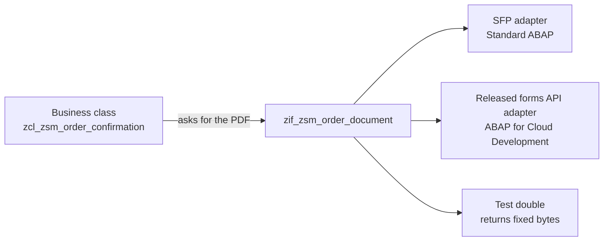

# 28 — Adobe Forms and PDF Output

> **Lifecycle:** `CLASSIC BUT STILL RELEVANT`. Adobe forms built in `SFP` and called through the `FP_*` function modules are how Standard ABAP prints documents and creates PDFs. SAP's object classification lists those modules as classic APIs. In ABAP for Cloud Development, the released forms API (`CL_FP_ADS_UTIL`, `CL_FP_FDP_SERVICES`, `CL_FP_FORM_READER`) renders the PDF: `ABAP CLOUD / MODERN CONTEXT`, and `VERSION-DEPENDENT` in Standard ABAP. Smart Forms and SAPscript are `CLASSIC BUT STILL RELEVANT` for existing forms; this guide does not use them for new ones. See [21-Classic-vs-Modern-ABAP](../21-Classic-vs-Modern-ABAP/README.md).

## 📖 Introduction

An order confirmation, a delivery note, an invoice: business documents leave the system as print forms. In Standard ABAP a print form is an Adobe form. The program collects the data, the form arranges it on pages, and Adobe Document Services (ADS) renders a PDF, which is printed or handed back to the program.

This chapter covers:

- the form interface, the form and its context in transaction `SFP`;
- the layout, described but not taught;
- Adobe Document Services as a prerequisite;
- calling a form in Standard ABAP, and getting the PDF instead of printing it;
- handing the PDF on to a mail or a file;
- the released forms API of ABAP for Cloud Development, as far as it was verified;
- output behind an interface, so that callers are tested without a form;
- Smart Forms and SAPscript, which you meet in existing code.

The developer and the layout author are often different people. The developer owns the data and the call; the layout owns positions, fonts and page breaks. This chapter is written for the developer.

## 🗺️ Standard ABAP and ABAP for Cloud Development at a Glance

| Topic | Standard ABAP | ABAP for Cloud Development |
|---|---|---|
| Form objects | Form interface and form in `SFP` | Form templates in the ABAP repository, read by name **[verify: how form templates are created and maintained in the SAP BTP ABAP environment]** |
| Data | Import parameters of the form interface, filled by the calling program | A form data provider, for example a service definition, read as XML |
| Layout | Adobe LiveCycle Designer, opened from `SFP` | Adobe LiveCycle Designer **[verify]** |
| Call | `FP_FUNCTION_MODULE_NAME`, `FP_JOB_OPEN`, the generated function module, `FP_JOB_CLOSE` | `CL_FP_FORM_READER`, `CL_FP_FDP_SERVICES`, `CL_FP_ADS_UTIL=>render_pdf( )` |
| Rendering | Adobe Document Services | Adobe Document Services or SAP's forms service **[verify: which rendering service the SAP BTP ABAP environment requires]** |
| Printing | Spool request (`SP01`) | Print queue, `CL_PRINT_QUEUE_UTILS` |
| Release state | `FP_*` modules: classic API | `CL_FP_ADS_UTIL`, `CX_FP_ADS_UTIL`, `CL_FP_FDP_SERVICES`, `IF_FP_FDP_API`, `CX_FP_FDP_ERROR`, `CL_FP_FORM_READER`, `IF_FP_FORM_BASE_READER`, `CX_FP_FORM_READER`, `CL_PRINT_QUEUE_UTILS`: released |

The release states come from SAP's lists of released and classified objects. SAP's list for Standard ABAP marks the same forms objects as released, but the on-premise system used for this chapter did not contain `CL_FP_FORM_READER`, `IF_FP_FORM_BASE_READER` or `CX_FP_FORM_READER` ([Rule 1.3](../docs/ABAP-Development-Rules.md#13-in-standard-abap-prefer-a-released-api-over-an-unreleased-one-when-both-exist)).

## 🧩 Form Interface, Form and Context (SFP)

Transaction `SFP` maintains two objects:

- **Form interface.** The data the form receives. It has:
  - import parameters, filled by the calling program;
  - global data and types;
  - initialization code, which runs before the layout is filled;
  - form routines, called from the initialization code.
- **Form.** It names one interface and adds:
  - the **context**, which selects the interface data the layout may use and adds conditions, loops over tables, texts, addresses and graphics;
  - the **layout**, drawn in Adobe LiveCycle Designer.

Activating the form generates a function module. Its name is generated, so programs ask for it by form name at runtime ([Calling a Form in Standard ABAP](#-calling-a-form-in-standard-abap)).

Form and form interface names have at most 30 characters (domain `FPNAME`). Name them by the naming table: `zsm_af_` for forms and `zsm_afi_` for form interfaces ([Rule 2.6](../docs/ABAP-Development-Rules.md#26-name-development-objects-by-the-object-naming-table)). The form objects cannot be created through ADT in either system used for this chapter, so they are created in `SFP`.

**Prepare the data before the form.** The initialization code and the form routines can select data, and many existing forms do. Logic there runs only when the form is rendered, cannot be unit-tested and is hidden from the program that calls the form. Read and prepare the data in a class, and pass the result through the interface ([Rule 5.13](../docs/ABAP-Development-Rules.md#513-prepare-form-data-in-abap-keep-selections-and-business-logic-out-of-form-code-and-layout-scripts)).

**Example E6 — initialization code that only arranges data.**

> 📝 **Contextual snippet** — the initialization code of a form interface with the import parameter `items` (a table of `zsm_s_order_item` with `position` and `quantity`) and the global data `printed_items` of the same type. The calling program has already read, checked and priced the items.

```abap
" Arrange what the program passed in; no SELECT, no business rule
printed_items = VALUE #( FOR item IN items WHERE ( quantity > 0 )
                         ( item ) ).
SORT printed_items BY position.
```

## 🎨 The Layout (Described, Not Taught)

The layout is drawn in Adobe LiveCycle Designer, a separate program installed on the developer's PC and started from `SFP`. It arranges master pages and body pages, subforms that grow with their content, tables, images, barcodes and QR codes. Each layout field is bound to a context node.

The layout can also run scripts, in FormCalc or JavaScript, on events such as initialization or entering a field. Scripts can show, hide or format fields. Keep them to presentation:

- No business rules in a script. A rule there exists only in the PDF and is tested by nobody ([Rule 5.13](../docs/ABAP-Development-Rules.md#513-prepare-form-data-in-abap-keep-selections-and-business-logic-out-of-form-code-and-layout-scripts)).
- No user names or other personal data written into a script ([Rule 8.8](../docs/ABAP-Development-Rules.md#88-log-no-secrets-and-no-personal-data-beyond-what-the-purpose-needs)). The program decides what the form shows.

Teaching the designer is outside this guide; see the [Scope Note](#-scope-note).

## ⚙️ Adobe Document Services

The form runtime in ABAP does not render PDFs itself. It sends the layout and the data to Adobe Document Services (ADS), which returns the PDF or the print data. ADS is a prerequisite that Basis installs and connects. Without it, every form call fails, whichever program makes it.

What a developer needs to know:

- The connection is an RFC destination. `SFPOUTPUTPARAMS-CONNECTION` can name one; SAP's own test program fills it from `CL_FP=>get_ads_connection( )`, the system's default connection. Leave it empty in application code, so the default applies ([Rule 8.5](../docs/ABAP-Development-Rules.md#85-never-hard-code-credentials-hosts-or-destinations)).
- The system used for this chapter contains the program `FP_TEST_ADS_CONNECTIVITY`, whose title says that it tests the ADS connection. Ask Basis before blaming the form.
- After an ADS error, the classic function module `FP_GET_LAST_ADS_ERRSTR` returns ADS's error text.

ADS configuration is outside this guide.

## 🖨️ Calling a Form in Standard ABAP

A form call has four steps:

1. **`FP_FUNCTION_MODULE_NAME`** returns the name of the generated function module for a form name. It raises the class-based exceptions `CX_FP_API_REPOSITORY`, `CX_FP_API_USAGE` and `CX_FP_API_INTERNAL`, so it is called inside `TRY … CATCH`. According to the ABAP Keyword Documentation, the addition `EXCEPTIONS` cannot be specified for a function module that declares class-based exceptions.
2. **`FP_JOB_OPEN`** opens the print job. It takes the output parameters (`CHANGING ie_outputparams TYPE sfpoutputparams`) and raises the classic exceptions `cancel`, `usage_error`, `system_error` and `internal_error`.
3. **The generated function module** renders one document. Its standard parameters are `/1BCDWB/DOCPARAMS` (document parameters, type `SFPDOCPARAMS`) and `/1BCDWB/FORMOUTPUT` (the result, type `FPFORMOUTPUT`), next to the import parameters of the form interface. Callers handle the classic exceptions `usage_error`, `system_error` and `internal_error`. Several documents can be rendered within one job.
4. **`FP_JOB_CLOSE`** closes the job and returns a result of type `SFPJOBOUTPUT`, which lists, among other things, the spool requests created. It raises `usage_error`, `system_error` and `internal_error`.

The output parameters (`SFPOUTPUTPARAMS`) control the job. Among them:

| Field | Meaning |
|---|---|
| `nodialog` | No print dialog |
| `preview` | Show a print preview |
| `getpdf` | Return the PDF to the program |
| `dest` | Output device (from the include `SFPPRIP`) |
| `reqimm`, `copies` | Print immediately; number of copies |
| `connection` | ADS destination; empty means the default |

The document parameters (`SFPDOCPARAMS`) carry the language and country of the document (`langu`, `country`), and the flag `fillable` for interactive forms.

`FP_JOB_OPEN` and `FP_JOB_CLOSE` call the internal modules `FPCOMP_JOB_OPEN` and `FPCOMP_JOB_CLOSE`. Call the `FP_*` modules, not the internal ones: only the `FP_*` modules appear in SAP's object classification.

**Never hard-code the form name or the printer.** Both change per company, country or document type. Take them from configuration or from the user's defaults ([Rule 8.15](../docs/ABAP-Development-Rules.md#815-take-output-devices-and-form-names-from-configuration-never-hard-code-a-printer)). The example below receives the form name in its constructor and prints nothing, so it needs no device.

## 📄 Getting the PDF Instead of Printing

With `getpdf` set, ADS returns the PDF to the program, in `FPFORMOUTPUT-pdf`, an `xstring`. According to SAP Help, no spool request is created when `getpdf` is set; printing the same document as well needs a second call without `getpdf`. In the system used for this chapter, `FPCOMP_JOB_CLOSE` shows a preview only when no PDF, print data or XML is requested, so `preview` has no effect together with `getpdf`.

**Example E3 — the classic adapter.** Target: Standard ABAP. The class implements the renderer interface of E1 ([Design: Output Behind an Interface](#-design-output-behind-an-interface)) with the `FP_*` modules and returns the PDF.

```abap
"! Renders the order document with an Adobe form through the SFP
"! function modules and returns the PDF. Nothing is printed.
CLASS zcl_zsm_order_document_sfp DEFINITION PUBLIC FINAL CREATE PUBLIC.
  PUBLIC SECTION.
    INTERFACES zif_zsm_order_document.

    "! @parameter form_name | Form name from configuration (Rule 8.15)
    METHODS constructor
      IMPORTING form_name TYPE fpname.

  PRIVATE SECTION.
    DATA form_name TYPE fpname.

    METHODS generated_module_name
      RETURNING VALUE(result) TYPE funcname
      RAISING   zcx_zsm_document_failed.
ENDCLASS.


CLASS zcl_zsm_order_document_sfp IMPLEMENTATION.
  METHOD constructor.
    me->form_name = form_name.
  ENDMETHOD.

  METHOD zif_zsm_order_document~render.
    DATA(module_name) = generated_module_name( ).

    " getpdf returns the PDF to the program instead of creating a spool request
    DATA(output_parameters) = VALUE sfpoutputparams( getpdf   = abap_true
                                                     nodialog = abap_true ).
    CALL FUNCTION 'FP_JOB_OPEN'
      CHANGING
        ie_outputparams = output_parameters
      EXCEPTIONS
        cancel          = 1
        usage_error     = 2
        system_error    = 3
        internal_error  = 4
        OTHERS          = 5.
    IF sy-subrc <> 0.
      RAISE EXCEPTION TYPE zcx_zsm_document_failed USING MESSAGE
        EXPORTING
          order_id = order_id.
    ENDIF.

    DATA(document_parameters) = VALUE sfpdocparams( langu = sy-langu ).
    DATA form_output TYPE fpformoutput.

    " order_id is the import parameter of the form interface
    CALL FUNCTION module_name
      EXPORTING
        /1bcdwb/docparams  = document_parameters
        order_id           = order_id
      IMPORTING
        /1bcdwb/formoutput = form_output
      EXCEPTIONS
        usage_error        = 1
        system_error       = 2
        internal_error     = 3
        OTHERS             = 4.
    DATA(form_failed) = xsdbool( sy-subrc <> 0 ).
    DATA(form_message) = VALUE symsg( msgid = sy-msgid
                                      msgty = sy-msgty
                                      msgno = sy-msgno
                                      msgv1 = sy-msgv1
                                      msgv2 = sy-msgv2
                                      msgv3 = sy-msgv3
                                      msgv4 = sy-msgv4 ).

    " The job is closed also after a failed form call; the form's message is kept
    CALL FUNCTION 'FP_JOB_CLOSE'
      EXCEPTIONS
        usage_error    = 1
        system_error   = 2
        internal_error = 3
        OTHERS         = 4.
    DATA(close_failed) = xsdbool( sy-subrc <> 0 ).

    IF form_failed = abap_true.
      RAISE EXCEPTION TYPE zcx_zsm_document_failed
        MESSAGE ID form_message-msgid
        TYPE form_message-msgty
        NUMBER form_message-msgno
        WITH form_message-msgv1 form_message-msgv2 form_message-msgv3 form_message-msgv4
        EXPORTING
          order_id = order_id.
    ENDIF.
    IF close_failed = abap_true.
      RAISE EXCEPTION TYPE zcx_zsm_document_failed USING MESSAGE
        EXPORTING
          order_id = order_id.
    ENDIF.

    result = form_output-pdf.
  ENDMETHOD.

  METHOD generated_module_name.
    " FP_FUNCTION_MODULE_NAME raises class-based exceptions, not classic ones
    TRY.
        CALL FUNCTION 'FP_FUNCTION_MODULE_NAME'
          EXPORTING
            i_name     = form_name
          IMPORTING
            e_funcname = result.

      CATCH cx_fp_api_repository cx_fp_api_usage cx_fp_api_internal INTO DATA(form_error).
        RAISE EXCEPTION NEW zcx_zsm_document_failed( previous = form_error ).
    ENDTRY.
  ENDMETHOD.
ENDCLASS.
```

The class closes the job also after a failed form call, keeps the form's message, and raises it after closing. Whether the form runtime requires the close after a failure was not found in SAP Help **[verify: behaviour of `FP_JOB_CLOSE` after a failed call of the generated function module]**; closing does no harm, and a job left open is the riskier case.

> 📝 The generated function module is called with a computed name, so activation checks neither its parameters nor the form. `order_id` must match an import parameter of the form interface; compare it with the interface in `SFP` after every change ([09-Modularization](../09-Modularization/README.md#-calling-a-function-module)).

The class never commits ([Rule 7.10](../docs/ABAP-Development-Rules.md#710-let-the-top-level-caller-own-the-transaction-reusable-units-never-commit-work)).

## 📎 Handing the PDF On

A PDF in an `xstring` goes wherever binary content goes:

- **As a mail attachment:** convert and attach it as described in [24-Mail](../24-Mail/README.md#-attachments), with the content type `application/pdf`. The mail carries the identifiers the recipient needs, not more ([Rule 8.12](../docs/ABAP-Development-Rules.md#812-put-no-personal-data-into-a-mail-beyond-what-the-recipient-needs-send-identifiers-and-links-instead-of-payloads)).
- **To a file:** on the application server through a logical file name, or to the user's PC in dialog, as described in [11-Classical-Reports](../11-Classical-Reports/README.md#-writing-a-file-on-the-application-server) ([Rule 8.7](../docs/ABAP-Development-Rules.md#87-resolve-and-validate-file-paths-through-logical-file-names)).

E5 below turns the PDF into an attachment structure for the mail chapter's composer.

## ☁️ Forms in ABAP for Cloud Development

ABAP for Cloud Development has no `SFP` and no `FP_*` modules. The released API splits the work into three steps, read in the SAP BTP ABAP environment used for this chapter:

1. **`CL_FP_FORM_READER=>create_form_reader( iv_formname )`** returns an `IF_FP_FORM_BASE_READER` for a form template. `get_layout( )` returns the layout as an `xstring` (an XDP file); `get_fdp_name( )` returns the name of the form's data provider, which its ABAP Doc describes as, for example, a service definition. Errors raise `CX_FP_FORM_READER`.
2. **`CL_FP_FDP_SERVICES=>get_instance( iv_service_definition )`** returns an `IF_FP_FDP_API` for that data provider. `get_keys( )` returns the key fields; `read_to_xml_v2( it_select )` reads the data for given key values as XML. The older `read_to_xml( )` is marked as deprecated in its ABAP Doc. Errors raise `CX_FP_FDP_ERROR`.
3. **`CL_FP_ADS_UTIL=>render_pdf( )`** takes the XML data, the XDP layout and a locale such as `en_US`, and exports the PDF (`ev_pdf`), the page count and a trace string. Errors raise `CX_FP_ADS_UTIL`. `render_4_pq( )` renders print data for a print queue instead.

`CL_PRINT_QUEUE_UTILS` offers `create_queue_itemid( )`, `create_queue_item_by_data( )` and `get_pqname_list( )` for print queues **[verify: the parameters of `CL_PRINT_QUEUE_UTILS` and how print queues are set up]**. How form templates are created and maintained, and which forms service must be set up, are not covered here **[verify]**.

**Example E4 — the cloud adapter.** Target: ABAP for Cloud Development.

```abap
"! Renders the order document from a form template and the form's data
"! service through the released forms API, and returns the PDF.
"! Nothing is printed.
CLASS zcl_zsm_order_document_ads DEFINITION PUBLIC FINAL CREATE PUBLIC.
  PUBLIC SECTION.
    INTERFACES zif_zsm_order_document.

    TYPES template_name TYPE c LENGTH 30.

    "! @parameter form_name | Form name from configuration (Rule 8.15)
    "! @parameter locale | Locale of the rendering, for example en_US
    METHODS constructor
      IMPORTING form_name TYPE template_name
                locale    TYPE string.

  PRIVATE SECTION.
    DATA form_name TYPE template_name.
    DATA locale    TYPE string.
ENDCLASS.


CLASS zcl_zsm_order_document_ads IMPLEMENTATION.
  METHOD constructor.
    me->form_name = form_name.
    me->locale    = locale.
  ENDMETHOD.

  METHOD zif_zsm_order_document~render.
    TRY.
        DATA(form) = cl_fp_form_reader=>create_form_reader( form_name ).
        DATA(data_service) = cl_fp_fdp_services=>get_instance( CONV #( form->get_fdp_name( ) ) ).

        " The data service of this form has the order id as its only key
        DATA(select_keys) = data_service->get_keys( ).
        LOOP AT select_keys ASSIGNING FIELD-SYMBOL(<key>).
          <key>-value = order_id.
        ENDLOOP.

        cl_fp_ads_util=>render_pdf( EXPORTING iv_xml_data   = data_service->read_to_xml_v2( select_keys )
                                              iv_xdp_layout = form->get_layout( )
                                              iv_locale     = locale
                                    IMPORTING ev_pdf        = result ).

      CATCH cx_fp_form_reader cx_fp_fdp_error cx_fp_ads_util INTO DATA(error).
        RAISE EXCEPTION NEW zcx_zsm_document_failed( previous = error
                                                     order_id = order_id ).
    ENDTRY.
  ENDMETHOD.
ENDCLASS.
```

E4 assumes a form template whose data provider has the order id as its only key. With more keys, map each key name to its value instead of the loop.

> ⚠️ **VERSION-DEPENDENT: the released forms API in Standard ABAP.** SAP's list for Standard ABAP marks these objects as released, but the on-premise system used for this chapter contained `CL_FP_ADS_UTIL`, `CL_FP_FDP_SERVICES`, `IF_FP_FDP_API` and `CL_PRINT_QUEUE_UTILS` and not `CL_FP_FORM_READER`. E4 was therefore activated only in ABAP for Cloud Development. Check your release ([Rule 1.3](../docs/ABAP-Development-Rules.md#13-in-standard-abap-prefer-a-released-api-over-an-unreleased-one-when-both-exist)).

## 🧱 Design: Output Behind an Interface

Which form technology renders a document depends on the language version and the release; what the document is for does not. The business code asks an interface for "the PDF of order X" and does not know whether `SFP`, the released API or a test double answers. This is the pattern of [24-Mail](../24-Mail/README.md#-design-compose-the-mail-send-it-through-an-interface), [25-HTTP-REST](../25-HTTP-REST/README.md#-design-keep-http-behind-an-interface) and [27-Lock-Objects](../27-Lock-Objects/README.md#-design-the-lock-behind-an-interface) ([Rule 5.4](../docs/ABAP-Development-Rules.md#54-depend-on-interfaces-and-receive-dependencies-through-the-constructor)).



**Example E1 and E2 — the contract.** Target: Standard ABAP and ABAP for Cloud Development. The exception class carries a T100 message, so the classic adapter can pass on the message of the form runtime. In a real system it inherits from the team's root of checked exceptions ([Rule 6.2](../docs/ABAP-Development-Rules.md#62-build-your-own-exception-hierarchy-below-zcx_zsm_)); here it inherits from `CX_STATIC_CHECK`, so the example stands alone.

```abap
"! Raised when the document of an order cannot be rendered. The cause
"! from the forms API travels as PREVIOUS; a classic error keeps its
"! message through the T100 interfaces.
CLASS zcx_zsm_document_failed DEFINITION
  PUBLIC
  INHERITING FROM cx_static_check
  FINAL
  CREATE PUBLIC.

  PUBLIC SECTION.
    INTERFACES if_t100_message.
    INTERFACES if_t100_dyn_msg.

    DATA order_id TYPE c LENGTH 10 READ-ONLY.

    METHODS constructor
      IMPORTING textid   LIKE if_t100_message=>t100key OPTIONAL
                previous LIKE previous OPTIONAL
                order_id TYPE csequence OPTIONAL.
ENDCLASS.


CLASS zcx_zsm_document_failed IMPLEMENTATION.
  METHOD constructor ##ADT_SUPPRESS_GENERATION.
    super->constructor( previous = previous ).
    CLEAR me->textid.
    IF textid IS INITIAL.
      if_t100_message~t100key = if_t100_message=>default_textid.
    ELSE.
      if_t100_message~t100key = textid.
    ENDIF.
    me->order_id = order_id.
  ENDMETHOD.
ENDCLASS.
```

```abap
"! Renders the document of an order as a PDF. Implementations return
"! the PDF; they never print and never commit.
INTERFACE zif_zsm_order_document PUBLIC.
  TYPES order_id TYPE c LENGTH 10.

  "! @parameter order_id | Order whose document is rendered
  "! @parameter result | The PDF
  "! @raising zcx_zsm_document_failed | The document could not be rendered
  METHODS render
    IMPORTING order_id      TYPE order_id
    RETURNING VALUE(result) TYPE xstring
    RAISING   zcx_zsm_document_failed.
ENDINTERFACE.
```

**Example E5 — the business class.** Target: Standard ABAP and ABAP for Cloud Development. It turns the PDF into an attachment for the mail composer of [24-Mail](../24-Mail/README.md#-design-compose-the-mail-send-it-through-an-interface).

```abap
"! Builds the confirmation attachment of an order. It asks the document
"! renderer for the PDF and names it; it knows nothing about forms.
CLASS zcl_zsm_order_confirmation DEFINITION PUBLIC FINAL CREATE PUBLIC.
  PUBLIC SECTION.
    TYPES: BEGIN OF attachment,
             file_name    TYPE string,
             content_type TYPE string,
             content      TYPE xstring,
           END OF attachment.

    METHODS constructor
      IMPORTING document TYPE REF TO zif_zsm_order_document.

    "! @parameter order_id | Order to confirm
    "! @parameter result | PDF attachment, ready for the mail composer
    "! @raising zcx_zsm_document_failed | No document could be rendered
    METHODS attachment_for
      IMPORTING order_id      TYPE zif_zsm_order_document=>order_id
      RETURNING VALUE(result) TYPE attachment
      RAISING   zcx_zsm_document_failed.

  PRIVATE SECTION.
    DATA document TYPE REF TO zif_zsm_order_document.
ENDCLASS.


CLASS zcl_zsm_order_confirmation IMPLEMENTATION.
  METHOD constructor.
    me->document = document.
  ENDMETHOD.

  METHOD attachment_for.
    DATA(pdf) = document->render( order_id ).
    IF pdf IS INITIAL.
      " An empty result would become an attachment nobody can open
      RAISE EXCEPTION NEW zcx_zsm_document_failed( order_id = order_id ).
    ENDIF.

    " ALPHA = OUT keeps the length of the character field; condense removes the blanks
    result = VALUE #( file_name    = |order_{ condense( |{ order_id ALPHA = OUT }| ) }.pdf|
                      content_type = 'application/pdf'
                      content      = pdf ).
  ENDMETHOD.
ENDCLASS.
```

> ⚠️ **`ALPHA = OUT` in a string template keeps the length of a character field.** Without `condense( )`, the order `0000000042` became `order_42` followed by blanks and `.pdf`. The unit test `returns_pdf_as_attachment` found this in both systems used for this chapter.

## 🧯 Exceptions and Errors

| Source | Kind | Handling |
|---|---|---|
| `FP_FUNCTION_MODULE_NAME` | Class-based: `CX_FP_API_REPOSITORY`, `CX_FP_API_USAGE`, `CX_FP_API_INTERNAL` | `TRY … CATCH`, keep the cause as `previous` ([Rule 6.8](../docs/ABAP-Development-Rules.md#68-keep-the-cause-when-converting-an-exception-pass-it-as-previous)) |
| `FP_JOB_OPEN`, generated module, `FP_JOB_CLOSE` | Classic exceptions with a message in `sy-msg*` | Convert to a class-based exception with the message ([Rule 6.9](../docs/ABAP-Development-Rules.md#69-turn-sy-subrc-and-bapi-return-tables-into-exceptions-at-the-boundary)) |
| `CL_FP_FORM_READER`, `IF_FP_FDP_API`, `CL_FP_ADS_UTIL` | Class-based: `CX_FP_FORM_READER`, `CX_FP_FDP_ERROR`, `CX_FP_ADS_UTIL` | `TRY … CATCH`, keep the cause |

Catch the specific exceptions ([Rule 6.6](../docs/ABAP-Development-Rules.md#66-catch-specific-exceptions)). The adapter raises one exception of its own, `zcx_zsm_document_failed`, so callers do not depend on the form technology. Where the message reaches a user is the UI layer's decision ([18-Debugging](../18-Debugging/README.md#-exception-handling)).

## 🧪 Testing Without a Form

A unit test never renders: rendering needs ADS, a form and a layout, and its result is a binary file that is hard to assert. The business class is tested with a double for `zif_zsm_order_document` ([22-ABAP-Unit](../22-ABAP-Unit/README.md#-test-doubles-through-interfaces), [Rule 10.6](../docs/ABAP-Development-Rules.md#106-replace-dependencies-with-test-doubles-through-interfaces-and-cl_abap_testdouble)). The adapters are thin; they are checked once against a real form in a system where ADS is set up.

**E5's test include:**

```abap
"! Test double for the renderer: returns a fixed PDF, records the
"! requested orders, and can fail. It never renders anything.
CLASS lth_order_document DEFINITION FINAL FOR TESTING.
  PUBLIC SECTION.
    INTERFACES zif_zsm_order_document.

    TYPES order_ids TYPE STANDARD TABLE OF zif_zsm_order_document=>order_id WITH EMPTY KEY.

    DATA requested_orders TYPE order_ids READ-ONLY.

    METHODS constructor
      IMPORTING pdf TYPE xstring.
    METHODS fail_on_render.

  PRIVATE SECTION.
    DATA pdf  TYPE xstring.
    DATA fail TYPE abap_bool.
ENDCLASS.


CLASS lth_order_document IMPLEMENTATION.
  METHOD constructor.
    me->pdf = pdf.
  ENDMETHOD.

  METHOD fail_on_render.
    fail = abap_true.
  ENDMETHOD.

  METHOD zif_zsm_order_document~render.
    INSERT order_id INTO TABLE requested_orders.
    IF fail = abap_true.
      RAISE EXCEPTION NEW zcx_zsm_document_failed( order_id = order_id ).
    ENDIF.
    result = pdf.
  ENDMETHOD.
ENDCLASS.


CLASS ltc_order_confirmation DEFINITION FINAL FOR TESTING
  RISK LEVEL HARMLESS
  DURATION SHORT.

  PRIVATE SECTION.
    " The first bytes of every PDF file: %PDF-
    CONSTANTS pdf_start TYPE xstring VALUE '255044462D'.

    METHODS returns_pdf_as_attachment FOR TESTING RAISING cx_static_check.
    METHODS asks_for_the_given_order FOR TESTING RAISING cx_static_check.
    METHODS rejects_empty_document FOR TESTING RAISING cx_static_check.
    METHODS passes_render_failure_on FOR TESTING RAISING cx_static_check.
ENDCLASS.


CLASS ltc_order_confirmation IMPLEMENTATION.
  METHOD returns_pdf_as_attachment.
    " given
    DATA(cut) = NEW zcl_zsm_order_confirmation( NEW lth_order_document( pdf_start ) ).

    " when
    DATA(attachment) = cut->attachment_for( '0000000042' ).

    " then
    cl_abap_unit_assert=>assert_equals( act = attachment-content
                                        exp = pdf_start ).
    cl_abap_unit_assert=>assert_equals( act = attachment-content_type
                                        exp = `application/pdf` ).
    cl_abap_unit_assert=>assert_equals( act = attachment-file_name
                                        exp = `order_42.pdf` ).
  ENDMETHOD.

  METHOD asks_for_the_given_order.
    " given
    DATA(document) = NEW lth_order_document( pdf_start ).
    DATA(cut) = NEW zcl_zsm_order_confirmation( document ).

    " when
    cut->attachment_for( '0000000042' ).

    " then
    cl_abap_unit_assert=>assert_equals( act = document->requested_orders
                                        exp = VALUE lth_order_document=>order_ids( ( '0000000042' ) ) ).
  ENDMETHOD.

  METHOD rejects_empty_document.
    " given
    DATA(cut) = NEW zcl_zsm_order_confirmation( NEW lth_order_document( VALUE #( ) ) ).

    TRY.
        " when
        cut->attachment_for( '0000000042' ).
        cl_abap_unit_assert=>fail( 'An empty document must not become an attachment' ).

      CATCH zcx_zsm_document_failed INTO DATA(failed).
        " then
        cl_abap_unit_assert=>assert_equals( act = failed->order_id
                                            exp = '0000000042' ).
    ENDTRY.
  ENDMETHOD.

  METHOD passes_render_failure_on.
    " given
    DATA(document) = NEW lth_order_document( pdf_start ).
    document->fail_on_render( ).
    DATA(cut) = NEW zcl_zsm_order_confirmation( document ).

    TRY.
        " when
        cut->attachment_for( '0000000042' ).
        cl_abap_unit_assert=>fail( 'A render failure must reach the caller' ).

      CATCH zcx_zsm_document_failed INTO DATA(failed).
        " then
        cl_abap_unit_assert=>assert_equals( act = failed->order_id
                                            exp = '0000000042' ).
    ENDTRY.
  ENDMETHOD.
ENDCLASS.
```

> 📝 **Activation record.** E1 (`zif_zsm_order_document`), E2 (`zcx_zsm_document_failed`) and E5 (`zcl_zsm_order_confirmation` with its test include) were activated in both ABAP language versions: Standard ABAP and ABAP for Cloud Development. The 4 test methods of E5 were run in both versions; the first run failed in `returns_pdf_as_attachment` (the `ALPHA = OUT` length above), and after the fix the test run passed in both. E3 (`zcl_zsm_order_document_sfp`) was activated in Standard ABAP. E4 (`zcl_zsm_order_document_ads`) was activated in ABAP for Cloud Development; its first version did not pass the syntax check, because a type and an attribute shared the name `form_name`, and the type was renamed. E4 was not activated in Standard ABAP, because the on-premise system lacks `CL_FP_FORM_READER`. The check tools returned no warnings. E3 and E4 were not run: no PDF was rendered, ADS was not called, no print job was opened and nothing was printed. No form, form interface or Smart Form was created, and nothing was transported.

## 🕰️ Smart Forms and SAPscript

> **Lifecycle:** `CLASSIC BUT STILL RELEVANT`. Existing programs print with Smart Forms and SAPscript, and they keep working. SAP's object classification lists their function modules as classic APIs, like the `FP_*` modules. This guide recommends Adobe forms for new forms; whether SAP still develops Smart Forms could not be verified in SAP Help **[verify]**. Neither technology is released for ABAP for Cloud Development.

- **Smart Forms** (transaction `SMARTFORMS`) are maintained in a graphical editor in SAP GUI. Like Adobe forms, they generate a function module, which a program finds with `SSF_FUNCTION_MODULE_NAME` (classic exceptions `no_form`, `no_function_module`). The generated module takes optional parameters such as `control_parameters`, `output_options` and `user_settings`, the form's own parameters, and raises `formatting_error`, `internal_error`, `send_error` and `user_canceled`.
- **SAPscript** forms (transaction `SE71`) are the oldest technology. A print program drives them statement by statement with function modules such as `OPEN_FORM`.

According to SAP Help, `SMARTFORMS` can migrate a Smart Form into a form and a form interface for `SFP` (menu Utilities, Migration). The migrated objects start inactive, and SAP Help itself notes that a new form can be less work than repairing a migrated one.

**Example E7 — a Smart Forms call in existing code.**

> 📝 **Contextual snippet** — `CLASSIC BUT STILL RELEVANT`. Existing code; assumes a Smart Form such as `zsm_sf_order` with the import parameter `order_id`, and its name in `form_name`, read from configuration ([Rule 8.15](../docs/ABAP-Development-Rules.md#815-take-output-devices-and-form-names-from-configuration-never-hard-code-a-printer)). New forms are Adobe forms called as in E3.

```abap
DATA module_name TYPE rs38l_fnam.

CALL FUNCTION 'SSF_FUNCTION_MODULE_NAME'
  EXPORTING
    formname           = form_name
  IMPORTING
    fm_name            = module_name
  EXCEPTIONS
    no_form            = 1
    no_function_module = 2
    OTHERS             = 3.
IF sy-subrc <> 0.
  RETURN.
ENDIF.

CALL FUNCTION module_name
  EXPORTING
    order_id         = order_id
  EXCEPTIONS
    formatting_error = 1
    internal_error   = 2
    send_error       = 3
    user_canceled    = 4
    OTHERS           = 5.
```

When such a program is changed, keep the form, and move what you touch out of the print program into a class, as for any classic code ([21-Classic-vs-Modern-ABAP](../21-Classic-vs-Modern-ABAP/README.md#-decision-table)).

## 🧭 Scope Note

Not covered in this chapter:

- **Adobe LiveCycle Designer** and layout techniques such as conditional page breaks, buttons and dynamic text styles.
- **ADS installation and configuration**, and SAP's forms service for SAP BTP.
- **Output management:** output determination through condition records (`NAST`), the Post Processing Framework (PPF) and the output control of SAP S/4HANA with BRF+ determination. They decide *when* a form is sent and to whom; this chapter starts once a program renders a form.
- **Interactive forms** that users fill in and send back.
- **Barcode and font configuration** for Smart Forms.

## ✅ Best Practices

- Read and prepare all data in ABAP; the form interface receives finished data ([Rule 5.13](../docs/ABAP-Development-Rules.md#513-prepare-form-data-in-abap-keep-selections-and-business-logic-out-of-form-code-and-layout-scripts)).
- Take form names and output devices from configuration ([Rule 8.15](../docs/ABAP-Development-Rules.md#815-take-output-devices-and-form-names-from-configuration-never-hard-code-a-printer)).
- Put form output behind an interface that returns the PDF, and test the callers with a double.
- Use `getpdf` when the PDF goes to a mail or a file; print in a separate job when both are needed.
- Call `FP_FUNCTION_MODULE_NAME` in `TRY … CATCH`, and convert the classic exceptions of the job modules with their message.
- Close every job you open, also after a failed form call.
- Use the released forms API in ABAP for Cloud Development, and check whether your Standard ABAP release has it.

## ⚠️ Common Mistakes

- Selecting data or computing totals in the initialization code, form routines or layout scripts.
- A hard-coded printer name in `SFPOUTPUTPARAMS-dest`, or a hard-coded form name in every caller.
- `EXCEPTIONS OTHERS = 1` on `FP_FUNCTION_MODULE_NAME`, which declares class-based exceptions.
- Ignoring `sy-subrc` after `FP_JOB_OPEN` or the generated module, so an empty PDF travels on.
- Calling the internal `FPCOMP_JOB_OPEN` or `FPCOMP_JOB_CLOSE` instead of `FP_JOB_OPEN` and `FP_JOB_CLOSE`.
- Expecting a spool request while `getpdf` is set.
- User names, personal data or business rules in layout scripts.
- Unit tests that render a real form.
- Starting a new form in Smart Forms or SAPscript.

## 🎤 Interview & Review Checkpoints

- Name the parts of an Adobe form and what activation generates.
- Explain the four steps of a form call and why the function module name is read at runtime.
- How does a program get the PDF instead of printing, and what happens to the spool request?
- Which exceptions does `FP_FUNCTION_MODULE_NAME` raise, and why can `EXCEPTIONS` not be used with it?
- What does ADS do, and what fails without it?
- How is a PDF rendered in ABAP for Cloud Development?
- Why should selections stay out of the form interface?
- How do you test a class that needs a PDF without rendering one?
- Where do Smart Forms and SAPscript stand, and how would you change a program that uses them?

## 🖥️ Related Transaction Codes

| T-code | Purpose |
|---|---|
| `SFP` | Form interfaces and forms (Adobe forms) |
| `SMARTFORMS` | Smart Forms, including migration to Adobe forms |
| `SE71` | SAPscript forms |
| `SE73` | SAPscript fonts |
| `SP01` | Spool requests |

## 🔗 Related Chapters

- [24-Mail](../24-Mail/README.md) — attaching the PDF to a mail
- [11-Classical-Reports](../11-Classical-Reports/README.md) — writing the PDF to a file
- [09-Modularization](../09-Modularization/README.md) — calling function modules, including dynamic names
- [18-Debugging](../18-Debugging/README.md) — messages and class-based exceptions
- [22-ABAP-Unit](../22-ABAP-Unit/README.md) — test doubles through interfaces
- [25-HTTP-REST](../25-HTTP-REST/README.md) — the same adapter pattern for HTTP
- [27-Lock-Objects](../27-Lock-Objects/README.md) — the previous chapter; the same pattern for locks
- [29-Transport-Quality-Gates](../29-Transport-Quality-Gates/README.md) — the next chapter: transports and quality gates
- [21-Classic-vs-Modern-ABAP](../21-Classic-vs-Modern-ABAP/README.md) — lifecycle of form technologies and the released forms API
